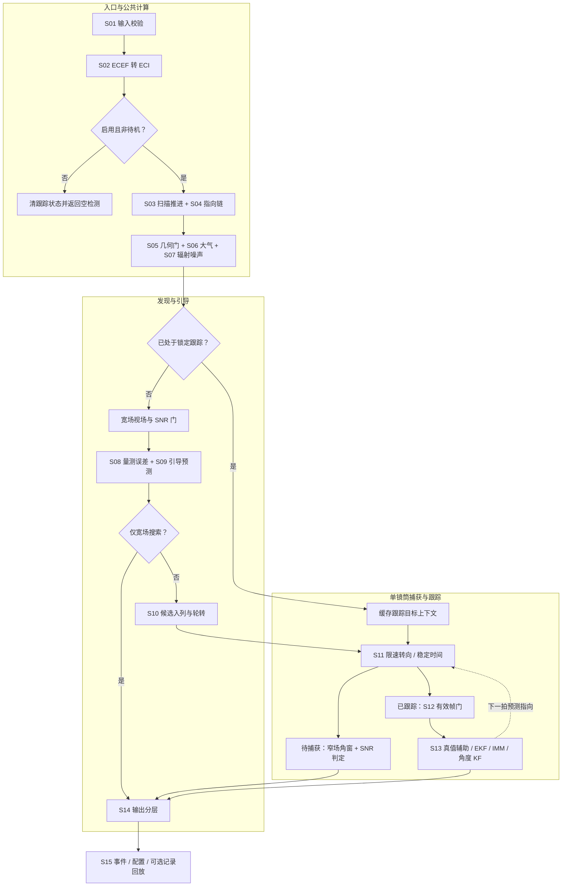
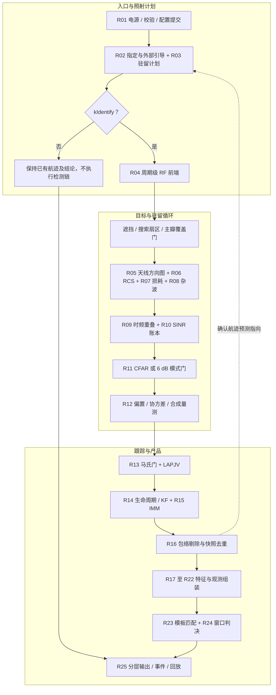

---
Status: active
Created: 2026-11-01
Updated: 2026-11-07
Purpose: 按当前源码说明 SBIRS 与 RIR 的执行流程、数据来源、输出边界及阶段算法
---

# SBIRS 与 RIR：源码工作流程及算法

本文只解释 `src/sbirs_sensor`、`src/remote_identification_radar` 及其实际调用的公共计算核，不把独立的融合、弹道推演、精度评估算进传感器内部。核对基线为本地源码，Git HEAD：`a5c7d5a0e3a65aaedeca00c98ffccf7d888a48ac`。下列默认值指 C++ 成员初始化值，不代表宿主或场景文件的实际配置。

判定以函数体为准，而非文件头、旧文档或算法名称：存在注释与执行语句不一致时，明确写出现状。公式是对执行语句的转写，不用教科书公式替换实现。源码链接均相对本文件；行号用于定位本次核对版本。

文中的 ECEF、ECI、ENU、LLA 分别为地心地固坐标、地心惯性坐标、东-北-天局部坐标与大地坐标；SNR、SINR 分别为信噪比、信干噪比；FOV、IFOV 分别为视场、瞬时视场，WFOV、NFOV 分别为宽场视场、窄场视场。

## 1. 流程描述

### 1.1 边界、坐标与数据性质

| 项目 | SBIRS 红外 | RIR 远程识别雷达 |
|---|---|---|
| 公共入口 | `SbirsSession::StepWithResult` | `RirSession::StepWithResult` |
| 核心编排 | `SbirsController::RunOnce` → `SbirsPipeline::RunCycle` | `RirSession::Impl::RunCycle` → `RirController::RunCycle` |
| 宿主提供 | UTC、卫星 ECEF 位置/速度、Body→ECI 姿态、场景目标位置/辐射强度等 | 平台 ECEF 位置、雷达局部 ENU 目标位置/速度/雷达截面积（RCS）、识别特征样本、可选射频（RF）场景 |
| 内部计算参考 | 位置/速度转 ECI；视场门在传感器系；检测角为 ECI 极坐标 | 目标与滤波状态为雷达局部 ENU；RF 传播使用 ECEF |
| 角度单位 | 内部几何多为 deg，滤波 rad，公开检测 rad | 内部扫描/特征多为 deg，量测角误差 rad |
| 公开主输出 | `SbirsOutputFrame`：扫描角、检测 ID/时刻/方位/俯仰/线性 SNR/阶段/检测标志 | `RirOutputFrame`：`feature_measurements` 与 `recognition_outputs` 两种产品 |
| 不能混入主输出的东西 | 场景目标身份、诊断距离、NIS、焦平面脱靶量在归属/诊断层，不是红外测距产品 | 航迹归属、滤波位置/速率摘要、RF 发射帧、诊断在 `RirCycleResult` 等层，不存在一个包揽这些字段的通用雷达 `DetectionRecord` |

两者都是以场景真值驱动的仿真模型，不是从图像或 I/Q 采样开始的原始信号处理器。SBIRS 用场景几何产生带误差角度；RIR 用雷达方程、标量处理增益、概率检测和合成量测驱动跟踪，识别另读场景提供的特征表。不能把“DFT 通道响应公式”写成已执行 FFT，也不能把“散射中心统计”写成已从回波反演出完整距离像。

两模型可独立运行。`SubmitExternalCue` 是 SBIRS 接收星间引导的可选入口；`SubmitExternalTrack` 是 RIR 接收位置/速度引导的可选入口。两个模型之间没有在各自 `StepWithResult` 内自动互调的强制链路；宿主负责换系、组装和递交。

### 1.2 SBIRS 单周期流程

图中未展开的失败路径必须与主线一起理解：

1. 校验失败不调用 pipeline；关机/待机进入 pipeline 的清理分支，不推进扫描相位。
2. 公共段按活动性、地球遮挡、任务距离先筛目标。已处于三种跟踪态且仍锁定的目标跳过宽场视场/SNR 门，交周期后段的窄场门检查；“等窄场捕获”还不是这种跟踪态。
3. 未锁定跟踪的目标，宽场角窗/SNR 门失败时，合法外部 cue 可旁路这两道门形成候选；不能旁路前面的遮挡与距离门。
4. `kWideSearch` 在候选输出后提前返回。否则先让达连续命中阈值的新候选入锁定集合，再按目标 ID 有序集合轮转一个主服务目标；不是按候选 SNR 优先级持续抢占镜筒。
5. 镜筒每周期只推进一次。已有跟踪目标共享本拍实际视场和稳定帧；不在此视场内的锁定目标本拍无量测，连续失败可丢锁。
6. 源码顺序为：先处理已有跟踪目标，再处理主服务目标的首次捕获，最后处理同帧免转向捕获与未处理的宽场候选。首次捕获成功记录不等于已经执行一次持续跟踪滤波。
7. 捕获/跟踪失败会释放锁定并回到 `kWideCandidate`；目标离场/不活动用 `kLost`；普通几何/宽场门失败多回 `kUndetected`。它们不是同一个“丢失”状态。

`wide_area_scan.enabled` 用独立参数覆盖宽场扫描几何、门限及宽场量测标定锚点，但没有凭空增加一套第三镜筒；是否进入窄场仍由 `work_mode` 的分支决定。仅宽场提前返回时阶段标为 `kWideAreaScan`，联合模式的宽场补发路径仍写 `kWideFieldSearch`。详见 S03、S08、S14。

### 1.3 RIR 单周期流程

执行顺序及关键分支：

1. `sensor_enabled=false` 在输入校验和待提交补丁之前早退；有效输入才提交 pending patch，构建指定任务和驻留计划。
2. 外部引导窗口有点时占用指定驻留之后的可用槽位，并抑制库内跟踪和固定光栅搜索；“cue 降级”只作标注，不把预算退回搜索。无外部窗口才给库内跟踪分配槽位并保留搜索额度。
3. RF 前端按首驻留指向只求解一次。本周期所有驻留复用其自发射波形、入射链和饱和标志。对外发射记录虽逐驻留生成，但未按驻留序号错开时间窗。
4. 场景目标先经遮挡/搜索域筛选，再按未识别优先、距离近优先排序。逐驻留遍历候选；目标首次被主瓣覆盖即标记 `covered`，即使本次检测失败，同周期后续驻留也不会重试。
5. 检测单元失败转效能级检测回退；它与 `kSnrFallback` 不是同一件事。后者是预先选择的准入模式，不是 CFAR 失败后的追加兜底。
6. 全部合成量测成批关联、更新生命周期及滤波，然后先过包络门/快照去重，才构造识别观测。旧文档“识别后去重”的顺序不符源码。
7. 检测成功不等于有识别特征，也不等于型号确认。数据库缺失、距离超限、特征不可用、质量不足、积累不足、匹配分低分别走不同路径。
8. 没有对全部识别特征施加“本拍匹配成功且航迹确认”的统一前置门：运动维自己要求 confirmed，其他维可来自场景特征表。观测组装也遍历保留的航迹快照，未强制本拍 hit。因此不能把识别次数直接当成独立雷达检出次数。

### 1.4 流程模块索引

| 编号 | SBIRS 阶段 | 编号 | RIR 阶段 |
|---|---|---|---|
| S01 | 周期入口、校验、电源 | R01 | 周期入口、校验、配置 |
| S02 | ECEF→ECI 与相对几何 | R02 | 指定识别与外部引导 |
| S03 | 宽场/大幅面扫描推进 | R03 | 搜索模式与驻留预算 |
| S04 | 安装、姿态、失准与指向扰动 | R04 | 发射波形、RF 前端与饱和 |
| S05 | 活动、遮挡、距离和视场门 | R05 | 候选覆盖与天线方向图 |
| S06 | 大气透过率 | R06 | 有效 RCS |
| S07 | 辐射、噪声、SNR、最大作用距离 | R07 | 传播与大气损耗 |
| S08 | 单帧/多帧量测误差 | R08 | 主瓣/旁瓣面杂波 |
| S09 | 本星/跨星 cue 与预测 | R09 | 接收窗脉冲数与干扰重叠 |
| S10 | 连续命中、入列和轮转 | R10 | 四支路处理与 SINR |
| S11 | 镜筒限速转向和首次捕获 | R11 | 统计检测与准入门 |
| S12 | 持续跟踪门与稳定帧 | R12 | 量测、偏置与协方差 |
| S13 | 真值辅助与三种估计后端 | R13 | 关联门与 LAPJV |
| S14 | 原生观测与归属输出 | R14 | 生命周期与 CV-KF |
| S15 | 配置、事件、记录与恢复 | R15 | IMM 多模型滤波 |
| — | — | R16 | 包络剔除与快照去重 |
| — | — | R17 | 运动拟合与运动特征 |
| — | — | R18 | RCS 特征 |
| — | — | R19 | 双通道极化特征 |
| — | — | R20 | 极化矩阵统计旁路 |
| — | — | R21 | 散射中心/一维距离像特征 |
| — | — | R22 | 特征装配和质量掩码 |
| — | — | R23 | 数据库与动态加权匹配 |
| — | — | R24 | 多周期积累、判决和保持 |
| — | — | R25 | 产品、反馈、诊断与回放 |

## 2. 流程模块详解

以下每个模块仅设“输入、输出、算法”三个小节。变量为源码字段或紧邻公式定义；凡真值、合成量测、滤波估计、验收统计，均区分来源。未在当前入口接线的能力不列为主流程算法。

### 2.1 S01 周期入口、校验与电源

#### 输入

| 变量 | 数据来源与单位 |
|---|---|
| `SbirsCycleInput`：`cycle_index`、`dt_sec`、`utc_julian_day` | 宿主仿真时钟；s、UTC 儒略日 |
| `satellite_position_ecef_m`、`satellite_velocity_ecef_m_per_s`、`satellite_attitude_eci_body_deg` | 宿主平台状态；m、m/s、deg |
| `scene` | 宿主目标列表；非零唯一 `target_id`、ECEF 位置、辐射强度和可选速度 |
| `sensor_enabled`、`mission.work_mode`、`frame_rate_hz` | 会话配置 |

#### 输出

| 变量 | 数据流向 |
|---|---|
| 合法输入 | `SbirsPipeline::RunCycle` |
| `status`、`abort_reason`、`issues` | `SbirsCycleResult`，调用方据此判断有效性 |
| 关机/待机的空检测帧及名义扫描角 | 调用方；不复用上一拍检测 |

#### 算法

源码：[SbirsSession.cpp](../src/sbirs_sensor/session/SbirsSession.cpp#L88)、[SbirsController.cpp](../src/sbirs_sensor/runtime/SbirsController.cpp#L32)、[SbirsInputValidation.cpp](../src/sbirs_sensor/session/SbirsInputValidation.cpp#L47)。

1. `StepWithResult` 调 `RunOnce`。先校验 `dt_sec>0` 且有限，且不超过 `10/max(frame_rate_hz, float_min)`；UTC 为正有限，卫星位置非零有限，卫星速度/姿态有限。
2. 逐目标校验非零唯一 ID、非零有限位置、非负有限辐射强度。声明未提供速度时，速度向量必须为零；否则要求有限。校验没有把注释中的“周期号合理性”实现成非零/递增周期检查。
3. 有输入错误即 `kRejectedInvalidInput/kValidationRejected`，不执行 pipeline。通过后 pipeline 先计算名义坐标/扫描参考，再判关机或 `kStandby`。
4. 关机/待机清目标状态、连续命中表、估计器、NFOV 锁定、指向协调器和 cue 预测器；返回 `executed=false`，controller 映射为 `kPoweredOff`。不在此路径推进扫描相位。
5. `PropagateSatelliteState` 是可选、显式调用的轨道辅助接口，不是 `StepWithResult` 自动执行的前置步骤；本章不将轨道传播算法算入传感器。

### 2.2 S02 坐标变换与相对几何

#### 输入

| 变量 | 数据来源与单位 |
|---|---|
| 卫星/目标 ECEF 位置、速度与 UTC | S01 输入 |
| `has_velocity_ecef_m_per_s` | 场景目标速度是否提供 |
| 姿态、安装角与失准 | S04；只影响传感器系转换，不改目标真值 |

#### 输出

| 变量 | 数据流向 |
|---|---|
| `SbirsEciSceneTarget`、卫星 ECI 状态 | S05–S13 几何、辐射、捕获与估计 |
| `los`、`range_m`、ECI 真值 az/el | S05、S07、S08 |
| `sensor_azimuth_deg`、`sensor_elevation_deg` | S05/S11/S12 视场门 |
| `omega_deg_per_sec_cached` | S08 的动态滞后 |

#### 算法

源码：[SbirsPipeline.cpp](../src/sbirs_sensor/pipeline/SbirsPipeline.cpp#L887)、[SbirsEciScene.cpp](../src/sbirs_sensor/pipeline/SbirsEciScene.cpp)、[SbirsGeometry.cpp](../src/sbirs_sensor/foundation/SbirsGeometry.cpp)。

UTC→GMST 后调用公共坐标函数旋转位置和速度。速度转换含地球自转输运项，不是仅把三个速度分量旋转。转换失败的防御分支保留原 ECEF 分量，GMST 失败取 0；这不等于该退化输入仍有正确 ECI 物理含义。

$$
\boldsymbol\ell=\mathbf p_t-\mathbf p_s,\quad R=\|\boldsymbol\ell\|,\quad
\alpha=\operatorname{atan2}(\ell_y,\ell_x),\quad
\beta=\arcsin(\ell_z/R),\quad
\omega=\frac{\|\boldsymbol\ell\times(\mathbf v_t-\mathbf v_s)\|}{R^2}.
$$

其中 $\mathbf p_t,\mathbf p_s$ 为目标、卫星 ECI 位置（m），$\mathbf v_t,\mathbf v_s$ 为相应速度（m/s），$\alpha,\beta$ 为相对 ECI 坐标轴的视线角，$\omega$ 为 rad/s，调用处换成 deg/s。目标未提供速度时相对速度按 `-v_satellite` 构造。S04 把同一 LOS 反旋进传感器系，门控用传感器系角，不能误写成当地地平系方位/仰角。

### 2.3 S03 宽场与大幅面扫描

#### 输入

| 变量 | 数据来源与单位 |
|---|---|
| `mission.scan_*`、WFOV FOV、`scan_direction` | 会话配置；deg、deg/s |
| `wide_area_scan.enabled` 及其独立参数块 | 会话配置；默认关闭 |
| `scan_phase_deg_`、`scan_leg_forward_`、`scan_row_index_` | 上周期运行态 |
| 卫星 ECI 位置、`dt_sec` | S02、S01 |

#### 输出

| 变量 | 数据流向 |
|---|---|
| `scan_mission`、`wide_min_snr_linear` | S05/S07，决定宽场几何及判决门 |
| 名义和实际扫描中心 | S04/S05；名义中心也用于 NFOV 执行器首次初始化 |
| 扫描相位/行索引 | 跨周期保留 |
| 覆盖区、驻留时间 | 验收旁路，不是新增检测输入 |

#### 算法

源码：[SbirsPipeline.cpp：模式覆盖](../src/sbirs_sensor/pipeline/SbirsPipeline.cpp#L825)、[扫描推进](../src/sbirs_sensor/pipeline/SbirsPipeline.cpp#L1139)、[覆盖采样](../src/sbirs_sensor/pipeline/SbirsPipeline.cpp#L299)。

1. 大幅面启用时复制 `mission`，覆盖宽场 FOV、扫描速率、方位起点/跨度/参考、俯仰栅格以及检测门。它未覆盖 `scan_direction`、任务距离、窄场参数或 `work_mode`。
2. 方位参考为绝对 ECI 时基准为 0；nadir-relative 时取 `atan2(-p_sy,-p_sx)`。后者按地球盘角半径 `asin(Re/|p_s|)` 与半 WFOV 裁剪有效扫描跨度，仍使用配置起点；不可改写为“任意扇区均严格重定位到交集起点”。
3. 用往复行程推进：将去/回腿对应的相位折成行程，加 `scan_rate*dt` 后对两倍跨度取模，再折回 `[0,span]`；跨过跨度边界就推进俯仰行。不是扫到终点瞬移回起点。

$$
n_{row}=1+\lfloor S_{el}/d_{el}\rfloor,\qquad
e_j=e_{start}+j\,d_{el}.
$$

$S_{el}$、$d_{el}$、$e_{start}$ 分别为俯仰跨度、行间距、起始中心角（deg），$j$ 为行索引。跨度为 0 时只有一行，取 `scan_center_el_deg`。非法有效方位跨度防御性回退配置跨度，再回退 360°。

4. 体稳定把扫描角作为传感器系指令；惯性稳定把期望 ECI 指向经 S04 逆解成传感器角。叠共模扰动后按机械限位钳制。帧输出扫描角取名义 ECI 中心，不是含扰动的实际中心。
5. 覆盖区旁路对矩形四边各 17 点、中心、视场内星下点、72 个临边候选射线求球面交点，取经纬度最小/最大值构造包围框；中心脱靶时用有效交点单位向量均值替代。不是精确球面覆盖多边形，也未对经度包围区间做最短跨日界线求解。驻留估计为方位 FOV/扫描速率，速率 0 时记 0。

### 2.4 S04 姿态、安装失准与实际指向扰动

#### 输入

| 变量 | 数据来源与单位 |
|---|---|
| `satellite_attitude_eci_body_deg` | 宿主，Body→ECI 欧拉角 |
| `orientation.mount_angles_deg`、`misalignment`、扫描限位 | 配置 |
| `policy.pointing_disturbance` | 共模/通道标准差、相关时间、振动幅度/频率/种子 |
| 名义扫描角或 NFOV 执行器 LOS | S03/S11 |

#### 输出

| 变量 | 数据流向 |
|---|---|
| `SbirsBoresightChain` 的正/逆旋转 | S02/S05/S09/S11/S12 |
| 实际 WFOV/NFOV 中心 | 几何门及焦平面脱靶量 |
| 失准、扰动随机状态和执行器状态 | S15 快照 |

#### 算法

源码：[SbirsBoresightChain.cpp](../src/sbirs_sensor/pipeline/SbirsBoresightChain.cpp#L47)、[SbirsPointingDisturbance.cpp](../src/sbirs_sensor/pipeline/SbirsPointingDisturbance.cpp#L90)、[EffectiveNfovPointing](../src/sbirs_sensor/pipeline/SbirsPipeline.cpp#L491)。

$$
C_{s\to i}=C_{b\to i}C_{b\to s}^{-1}C_{mis}^{-1},\qquad
\mathbf u_s=(\cos e\cos a,\cos e\sin a,\sin e)^T,\qquad
\mathbf u_i=C_{s\to i}\mathbf u_s.
$$

$C_{b\to i}$、$C_{b\to s}$、$C_{mis}$ 分别由姿态、安装角、失准角构建；$a,e$ 为传感器方位/俯仰，$\mathbf u_s,\mathbf u_i$ 为传感器系/ECI 单位方向。逆变换取正交矩阵转置。失准为常值偏置加一次确定性种子高斯抽样，在构造/应用配置时生成，不是每拍再抽一次。

共模与单 NFOV 通道各维护两个角轴的 Gauss–Markov 过程：

$$
\rho=e^{-\Delta t/T_c},\qquad x_k=\rho x_{k-1}+\sigma\sqrt{1-\rho^2}\,n_k,\qquad
x_{vib}=A\sin(2\pi f t+\phi).
$$

$\Delta t$ 为周期步长，$T_c$ 为配置相关时间（s），$\sigma$ 为平稳角标准差（deg），$n_k$ 为独立标准正态样本；$A,f,t,\phi$ 分别为振动幅度、频率、累计时间和种子派生相位。每执行周期推进一次；同周期多次 `Sample` 不推进随机数。幅度为 0 时对应项为 0。

WFOV 加共模角后再限位；NFOV 把执行器名义 ECI LOS 反解成传感器角，再叠共模和通道扰动，静态 `narrow_pointing_settle_error_deg` 只加在方位轴。安装失准、实际指向扰动和 S08 量测误差是三条不同链，不能全部归入同一个随机 σ。

### 2.5 S05 活动、遮挡、距离与视场门

#### 输入

| 变量 | 数据来源与单位 |
|---|---|
| 目标 `active`、ID、ECI 状态 | 场景/S02 |
| `mission.min_range_m/max_range_m` | 配置；默认 1 km / 50000 km |
| 实际视场中心与 FOV | S03/S04 |
| SNR、宽/窄门限 | S07 与配置；线性值 |
| 目标状态、锁定集合、合法外部 cue | 跨周期状态/S09 |

#### 输出

| 变量 | 数据流向 |
|---|---|
| 宽场合法候选 | S08/S09/S10 |
| `LockedTargetContext` | S12 跟踪段 |
| 释放、状态修改、排除 issue | S10/S13/S14/S15 |

#### 算法

源码：[逐目标公共段](../src/sbirs_sensor/pipeline/SbirsPipeline.cpp#L1476)、[宽场门](../src/sbirs_sensor/pipeline/SbirsPipeline.cpp#L1644)、[EarthOccultation.h](../src/common/geometry/EarthOccultation.h)。

先处理输入中已消失的目标：置 `kLost` 并释放锁、指向簿记、cue 和估计器。不活动目标同样处理。活动目标先判有限 LOS 线段是否穿入平均半径球地球，再判真值斜距是否在任务距离带内。失败回 `kUndetected` 并清连续命中/锁定/预测状态。

已有锁定跟踪态把几何/SNR 存入上下文后 `continue`，不再要求落在当拍 WFOV。其余目标检查矩形视场：

$$
|\operatorname{wrap}(a_t-a_c)|\le F_a/2,\qquad |e_t-e_c|\le F_e/2,\qquad \chi\ge\chi_{wide}.
$$

$a_t,e_t$ 为传感器系目标角，$a_c,e_c$ 为实际扫描中心，$F_a,F_e$ 为全宽 FOV（deg），`wrap` 为最短方位角差，$\chi$ 为线性红外 SNR。宽场门默认 4，窄场默认 6；大幅面覆盖后的宽场门默认 4.5。均为配置，不是在线背景 CFAR 估计。

宽场 FOV 或 SNR 不过时，有合法外部 cue 则进入外部候选路径；否则清锁/命中并给出视场越界轴或 SNR 主因诊断。SNR 归因是反事实损失比较，不是另一套检测算法。最大作用距离是 S07 诊断反解量；真正前置距离门仍是任务 `min/max_range_m`。

### 2.6 S06 大气透过率

#### 输入

| 变量 | 数据来源与单位 |
|---|---|
| `environment` | 基础透过率、天气、海况、湿度百分数、能见度 km、温度 ℃、交互权重 |
| 卫星和目标 ECI 位置 | S02；m |
| `kAtmosphereShellThicknessM` | 库内 100 km；气团数上限 10 |

#### 输出

| 变量 | 数据流向 |
|---|---|
| `path_transmittance` | S07 接收功率和最大距离反解 |
| 气象与噪声链诊断 | S14 验收旁路 |

#### 算法

源码：[SbirsEnvironmentModel.cpp](../src/sbirs_sensor/environment/SbirsEnvironmentModel.cpp#L66)。

天气查表晴/云/雨/雾为 0/0.05/0.15/0.20，海况低/中/高为 0.05/0.10/0.15。其余项及合成为：

$$
H=0.05\max(0,RH-50)/20,\quad
U=0.02\max(0,T-15)/10,
$$
$$
A=\operatorname{clip}_{[0,1]}(0.25W+0.15S+0.25H+0.25V-0.10U+I),\quad
\tau_{eff}=\operatorname{clip}_{[0,1]}(\tau_0)(1-A),\quad
\tau_{path}=\tau_{eff}^{X}.
$$

$RH,T,W,S$ 分别为湿度百分数、温度、天气表值、海况表值。$V$ 按能见度 `<1/<5/<10/其余 km` 取 0.20/0.10/0.05/0；$I$ 为启用的“湿度×能见度”和“雨×湿度”交互加权项；$\tau_0$ 为基础透过率。`clip` 为区间钳制。

以目标到卫星线段参数化，解与半径 `Re+100 km` 球的二次方程；两根区间裁到 `[0,1]` 后算球内弦长 $L$，气团数 $X=\operatorname{clip}_{[0,10]}(L/100\mathrm{km})$。$Re$ 为平均地球半径。纯空间路径不入壳，$X=0$，透过率为 1。这里是球壳均匀衰减近似，不是逐层光谱传输或云图追迹。

### 2.7 S07 辐射、噪声、SNR 与最大作用距离

#### 输入

| 变量 | 数据来源与单位 |
|---|---|
| `radiant_intensity_w_per_sr`、`range_m` | 场景辐射强度 $I_t$（W/sr），S02 斜距 $R$（m） |
| `optical_aperture_m`、`optical_transmission`、`detector_quantum_efficiency`、`integration_time_sec` | 硬件配置：孔径 $D$、光学透过率 $\tau_o$、量子效率 $\eta$、积分时间 $t$ |
| 噪声等效功率（NEP）、背景辐射亮度、像元间距、焦距、波段、读出噪声 RMS | `SbirsHardwareConfig` |
| 路径透过率、宽场门、任务上限 | S06、S03、配置 |

#### 输出

| 变量 | 数据流向 |
|---|---|
| `received_power_w`、`signal_energy_j`、`snr` | 视场检测、候选排序及诊断 |
| `photon_noise_w/readout_noise_w/total_noise_w` | 有效噪声分母；这些历史字段在当前实现存的是能量口径 |
| `max_detection_range_m` | 候选/归属和验收，不是公开被动测距输出 |

#### 算法

源码：[ComputeSnr](../src/sbirs_sensor/pipeline/SbirsPipeline.cpp#L619)、[SbirsRadiometry.cpp](../src/sbirs_sensor/foundation/SbirsRadiometry.cpp#L34)、[SbirsNoiseModel.cpp](../src/sbirs_sensor/foundation/SbirsNoiseModel.cpp#L37)。

$$
A_o=\pi D^2/4,\quad P_s=I_t A_o\tau_o\tau_{path}\eta/R^2,\quad E_s=P_st,
$$
$$
\Omega_{pix}=(d_{pix}/f_o)^2,\quad \lambda_c=10^{-6}(\lambda_{lo}+\lambda_{hi})/2,
\quad P_{bg}=L_{bg}A_o\tau_o\Omega_{pix},
$$
$$
E_{ph}=\sqrt{P_{bg}t\,hc/\lambda_c},\quad E_{read}=\max(0,P_{read})t,\quad
E_{nep}=\max(0,P_{nep})t,\quad E_n=\sqrt{E_{nep}^2+E_{ph}^2+E_{read}^2},\quad \chi=E_s/E_n.
$$

新增符号：$A_o$ 为口径面积；$d_{pix},f_o$ 为像元间距和光学焦距（m）；$\lambda_{lo/hi}$ 为配置波段端点（μm），$\lambda_c$ 为中心波长（m）；$L_{bg}$ 为背景辐射亮度；$P_{read},P_{nep}$ 为配置的读出噪声 RMS 和噪声等效功率（NEP）数值；$h,c$ 为普朗克常数、光速。$E_{ph},E_{read},E_{nep},E_n$ 是实现统一使用的噪声能量数值，$\chi$ 是线性 SNR。分项全零时 `ResolveEffectiveNoiseW` 回退 `max(1e-18, noise_equivalent_power_w)`。

不能沿用旧文档“噪声只有 NEP”或“SNR=功率/NEP”的写法。主流程先合成上述分项，再用信号能量除有效噪声。`ComputeInfraredSnrLinear` 虽保留简单接口，但 `ComputeSnr` 的主执行语句是上述复合噪声链。温度不直接反解热噪声；当前以 NEP 承担探测器噪声。

$$
R_{rad}=\sqrt{I_tA_o\tau_o\tau_{path}\eta t/(E_n\chi_{wide})},\quad
R_{geo}=\sqrt{\max(0,r_s^2-Re^2)}+\sqrt{\max(0,r_t^2-Re^2)},
\quad R_{max}=\min(R_{rad},R_{geo},R_{mission}).
$$

$r_s,r_t$ 为卫星、目标地心距离，$Re$ 为平均地球半径，$R_{mission}$ 为正的任务距离上限，$\chi_{wide}$ 为当前宽场/大幅面门。反解固定本拍 $\tau_{path}$，没有迭代求不同假想距离的大气透过率。源码入口为 [逐目标反解](../src/sbirs_sensor/pipeline/SbirsPipeline.cpp#L1599)。

验收旁路另由宽场门反推高斯尾虚警概率，再调用公共雷达概率函数求 Pd；它不回写宽场检测标志，不进行按 Pd 的随机检测。红外主检测仍是几何门与线性 SNR 阈值。

### 2.8 S08 单帧与多帧量测误差

#### 输入

| 变量 | 数据来源与单位 |
|---|---|
| 真值角、斜距、相对角速率 | S02；deg、m、deg/s |
| `policy.error_model` | 三类角 σ、距离比例 σ、带宽和随机种子 |
| `snr_linear`、`ifov_rad` | 宽场调用显式传 S07 SNR 与像元间距/焦距；其他调用见下文 |
| `frame_count` 与随机源 | S11/S12 稳定帧；宽场/估计量测/真值辅助输出为独立派生随机流 |

#### 输出

| 变量 | 数据流向 |
|---|---|
| `SbirsErrorBearing`：az/el/range | 宽场候选、cue、估计更新或 sensor-like 输出 |
| `SbirsFusedBearingResult` | S13 的融合量测及其实际多帧 σ |
| 单帧/融合 σ 诊断 | S12/S14；必须区别其取值路径 |

#### 算法

源码：[SbirsErrorModel.cpp](../src/sbirs_sensor/foundation/SbirsErrorModel.cpp#L86)、[头文件默认参数](../src/sbirs_sensor/foundation/SbirsErrorModel.h)、[实际调用](../src/sbirs_sensor/pipeline/SbirsTrackingCoordinator.cpp#L251)。

默认启用库内全局开关 `g_linear_snr_sigma_enabled`。单帧随机角标准差优先用 SNR 标定，而不是固定三项 RSS：

$$
q=\operatorname{clip}_{[0,1]}\big((35-s_{dB})/25\big),\qquad
\sigma_{lin}=(1+4q)\ \mu\mathrm{rad},\qquad s_{dB}=10\log_{10}\chi.
$$

$\chi$ 为线性 SNR，$s_{dB}$ 为其 dB 值，$q$ 为插值系数。大幅面宽场量测的 `LinearSigmaScope` 用配置锚点（默认 1.6、3.2 μrad）替换 1、5 μrad。函数体还有特殊分支：`snr_db<=0` 返回高 SNR 端的 σ（默认 1 μrad），不是注释声称的弱端 5 μrad；须按执行语句理解。

关闭线性标定后，单帧路径取：

$$
\sigma_f=\sqrt{\sigma_o^2+\sigma_a^2+\sigma_v^2},\qquad
\sigma=\sqrt{\sigma_f^2+\left[\frac{180}{\pi}\frac{IFOV}{\sqrt\chi}\right]^2},
$$
$$
b_{refr}=\frac{1.5\times10^{-6}}{R|\cos\beta|},\quad
b_{lag}=\frac{\omega}{2\pi f_{det}},\quad
\begin{bmatrix}\tilde\alpha\\\tilde\beta\end{bmatrix}
=\begin{bmatrix}\alpha\\\beta\end{bmatrix}+\sigma\begin{bmatrix}n_a\\n_e\end{bmatrix}
+(b_{refr}+b_{lag})\begin{bmatrix}1\\1\end{bmatrix},\quad
\tilde R=R(1+\sigma_{frac}n_r).
$$

$\sigma_o,\sigma_a,\sigma_v$ 对应 orbit/attitude/fov σ（deg），$IFOV$ 为像元瞬时角（rad）；光子项仅在 SNR/IFOV 为正时加入。$\alpha,\beta,R$ 为真值角/距，$\omega$ 为相对角速率，$f_{det}$ 为探测器带宽；$b$ 的实现单位 deg；$n_a,n_e,n_r$ 为 xorshift32+Box–Muller 产生的标准正态样本；$\sigma_{frac}$ 为距离比例标准差。折射/滞后作为两轴相同的确定性偏差，不是独立高斯噪声。

**多帧路径与单帧路径目前并不完全同源**：`ApplyAngularErrorModelFused` 先用三项 RSS 得 $\sigma_f$。当帧数 $N_f>1$、RSS>0 且随机源存在时，直接抽 $N_f$ 组 RSS 高斯角误差再均值，随机 σ 为 $\sigma_f/\sqrt{N_f}$，偏置只加一次，距离仍抽一次；它没有传入 SNR/IFOV，也没有调用 SNR 标定。退化单帧分支却调用带默认参数的 `ApplyAngularErrorModel`。因此不得写成“所有 NFOV 融合量测均按 SNR 标定 σ/√N”。S12 的帧 σ 诊断用 `ResolveFrameAngularSigmaDeg(snr,ifov)`，S13 实际融合量测/协方差使用另一条路径，存在数值口径差异。

### 2.9 S09 本星与跨星 cue、延迟预测

#### 输入

| 变量 | 数据来源与单位 |
|---|---|
| 本星宽场带误差角/距离 | S08 |
| `SubmitExternalCue` 消息 | 宿主递交：来源星 ECEF 位置、ECI 测角（deg）、距离（m）、目标 ID |
| `dt_sec`、`narrow_cue_latency_s` | 时钟和任务配置 |
| 场景真值运动 | 仅用于捕获成败的延迟真值角，不作为 cue 预测器历史 |

#### 输出

| 变量 | 数据流向 |
|---|---|
| `command_azimuth_deg/command_elevation_deg` | S10/S11 窄场指令 |
| `delayed_truth_*` | S11 首捕角窗检查 |
| `wide_cue_measurements` | 调用方可用来生成他星引导；模型不自动广播 |

#### 算法

源码：[SbirsCuePredictor.cpp](../src/sbirs_sensor/pipeline/SbirsCuePredictor.cpp#L40)、[外部 cue 消费](../src/sbirs_sensor/pipeline/SbirsPipeline.cpp#L1365)、[本星候选](../src/sbirs_sensor/pipeline/SbirsPipeline.cpp#L1806)。

1. 外部 cue 入运行队列，下次执行周期消费并清空；要求目标本拍在场景内、角有限、距离正、来源位置能转 ECI。同目标多条取最后一条。外部候选只旁路本星宽场 FOV/SNR 门，不绕过活动、地球遮挡、任务距离或 NFOV 门。
2. 跨星换视角按单源测角和距离重建估计点：$\hat{\mathbf p}_t=\mathbf p_{src}+\tilde R_{src}\mathbf u(\tilde\alpha_{src},\tilde\beta_{src})$，本星估计 LOS 为 $\hat{\mathbf p}_t-\mathbf p_{own}$。其中 `src/own` 为来源/本星 ECI 位置，$\mathbf u$ 为测角单位向量，$\tilde R$ 来自消息。这不是双 LOS 交会定位。
3. 预测器缓存每目标上一组有效测角。存在历史且时间/延迟有效时，角速度为相邻角差除 `dt_sec`，方位取最短角差；命令为当前测角加角速度乘 cue 延迟。无历史或延迟为 0，直接用当前测角。俯仰钳 ±90°、方位归一化。
4. 捕获门的延迟真值用 `(p_target+v_target*latency)−(p_satellite+v_satellite*latency)` 另算；它是仿真判定基准，不是传感器估计。候选排序的 SNR、距离仍取本星物理真值链。仅本星自发宽场候选进入 `wide_cue_measurements`，外部受话候选不再次递话。

### 2.10 S10 连续命中、候选入列与单镜筒轮转

#### 输入

| 变量 | 数据来源与单位 |
|---|---|
| `candidates`、`wfov_consecutive_hits_` | S05/S09；本星或外部候选都可能计入命中 |
| `wide_to_narrow_required_consecutive_hits` | 策略，默认 1 |
| `target_to_cue_source_`、`nfov_rotation_step_` | 跨周期锁定集合和游标 |

#### 输出

| 变量 | 数据流向 |
|---|---|
| `kAwaitingNfovAcquisition` 和锁定关系 | S11/S12 |
| 主服务目标、其指令 | S11 共享执行器 |
| 未被处理的宽场候选 | S14 宽场输出 |

#### 算法

源码：[SbirsNfovScheduler.cpp](../src/sbirs_sensor/pipeline/SbirsNfovScheduler.cpp#L63)、[连续命中筛选与轮转](../src/sbirs_sensor/pipeline/SbirsPipeline.cpp#L2135)。

先过滤已锁定候选和连续命中不足候选；剩余候选按 SNR 降序→真值距离升序→ID 升序排序，全部 `Acquire` 入 map，没有配置的最大并发锁数。入列后改 `kAwaitingNfovAcquisition`，不等于捕获成功。

主服务目标取 `LockedTargetIds()[rotation_step % size]`，随后游标加一；`LockedTargetIds` 来自按目标 ID 排序的 map。因此排序只影响入列处理顺序，不持续决定镜筒服务优先级。待捕获目标取 cue 预测命令；已有 estimated 目标取 S13 预测角；两种真值辅助态取本拍真值 LOS。

已跟踪目标共用一个实际 NFOV：在同一窗口内可共享稳定帧；分离目标轮空记门失败，到阈值释放。镜筒容量由转向速度/目标分离/帧率/丢锁容忍共同形成，不是同时运行多个独立窄场相机。

### 2.11 S11 限速指向、稳定时长与首次捕获

#### 输入

| 变量 | 数据来源与单位 |
|---|---|
| 主服务目标命令 ECI LOS | S10；先反解传感器角、限位，再正旋到 ECI |
| 共享执行器当前 LOS | 上周期指向 |
| 最大转速、稳定容差、静态 settle 误差、`dt_sec` | mission 配置；deg/s、deg、s |
| 延迟真值角、窄场 FOV、候选 SNR、窄场门 | S09、配置/S07 |

#### 输出

| 变量 | 数据流向 |
|---|---|
| `current_los`、`settled_duration_sec`、`status` | S12 帧数和本拍视场 |
| 首捕成功及跟踪来源状态 | S13 初始化，S14 首捕记录 |
| 转向中/超时/拒绝/捕获失败 | 宽场记录或失败归属、解锁回候选 |

#### 算法

源码：[SbirsPointingActuator.cpp](../src/sbirs_sensor/pipeline/SbirsPointingActuator.cpp#L118)、[SbirsPointingCoordinator.cpp](../src/sbirs_sensor/pipeline/SbirsPointingCoordinator.cpp#L47)、[SbirsNfovAcquisition.cpp](../src/sbirs_sensor/pipeline/SbirsNfovAcquisition.cpp)、[attempt_capture](../src/sbirs_sensor/pipeline/SbirsPipeline.cpp#L2323)。

首次使用以名义扫描中心初始化执行器。设当前/命令单位 LOS 的夹角为 $\gamma$（deg），最大转速为 $v_a$（deg/s），容差为 $\epsilon$（deg），则本拍最多转 $v_a\Delta t$；一步不够时沿当前×命令转轴按 Rodrigues 公式转到可达点，反向共线时另选确定性正交轴。

$$
t_{slew}=\max(0,(\gamma-\epsilon)/v_a),\qquad
t_{stable}=\max(0,\Delta t-t_{slew}).
$$

$\Delta t$ 为周期时长，$t_{stable}$ 为可用于稳定帧的时长；剩余夹角不大于容差才是 `kSettled`。捕获态只在目标被服务时累计等待时间，未稳定且累计达到 `180/v_a` 秒则超时；不是从排队开始就算等待超时。跟踪态不累计此超时。

稳定后的捕获判据在传感器系：延迟真值方位与“实际捕获指向方位+静态 settle 误差”的最短差不超过半方位 FOV，俯仰差不超过半俯仰 FOV，且 SNR≥窄场门。捕获调用先用 `EffectiveNfovPointing(..., static_error=0)`，静态误差由捕获请求再加一次，不能重复加。

成功后清 cue 历史和连续宽场命中，转为配置选定的 estimated/strict/sensor-like 跟踪态；estimated 在这里初始化滤波。首捕记录角通常来自宽场测角；strict 改真值，sensor-like 另调用单帧误差模型。已有跟踪段已在此前执行，故新捕获不在本拍再重复做跟踪更新。

转向中保留宽场检测；超时/拒绝/角窗或 SNR 捕获失败则释放锁并保留失败归属。同帧非服务待捕获目标若在当前 NFOV 内也尝试捕获；该分支只检查 `nfov_pointing_valid`，没有显式要求 `settled_frames>=1`，不可把它概括为必定“稳定满一帧才首捕”。

### 2.12 S12 持续跟踪几何/SNR 门与稳定帧

#### 输入

| 变量 | 数据来源与单位 |
|---|---|
| `locked_contexts` | S05 留下的已跟踪目标几何/SNR |
| 实际镜筒中心、稳定时长 | S11/S04 |
| `frame_rate_hz`、窄场全宽 FOV、SNR 门 | 配置 |
| `nfov_tracking_gate_loss_cycles` | 策略，默认 2 |

#### 输出

| 变量 | 数据流向 |
|---|---|
| `nfov_frame_count`、本拍量测是否可用 | S08/S13 |
| 几何/SNR 门、失败计数、滑行、丢锁 | S14 归属诊断与 S10 释放 |
| 焦平面脱靶量 | S14 归属/验收 |

#### 算法

源码：[SbirsPipeline.cpp](../src/sbirs_sensor/pipeline/SbirsPipeline.cpp#L2520)。

所有已有跟踪态共用本拍实际镜筒中心。矩形几何门通过且 `snr>=narrow_min_snr_linear` 时，帧数取 `max(0,lround(frame_rate_hz*settled_duration_sec))`；否则为 0。帧数至少 1 才过跟踪门。这里用四舍五入，不是 `floor`。

门过清连续失败；失败加一。失败数达到策略阈值释放锁回宽场候选；未到则 `nfov_tracking_coasting=true`，无量测只预测。estimated 每周期恰预测一次；主服务目标复用指向阶段已算的预测，其余跟踪目标在此预测，防止同拍推进两次。

诊断帧标准差由 `ResolveFrameAngularSigmaDeg(error_model, context.snr, IFOV)` 给出，融合诊断 σ 在有帧时除以帧数平方根；但实际传入 S13 的量测由 S08 的独立多帧路径生成，两者不能默认相等。

焦平面脱靶按 $x_f=f_o\tan(\Delta a)$、$y_f=f_o\tan(\Delta e)$ 生成，$f_o$ 为焦距（m），$\Delta a,\Delta e$ 为目标传感器系角与实际指向的逐轴差（转 rad）；除以像元间距得像素数。公开归属存米值，验收可同时记录像素。这是几何投影，不是从焦平面图像提取的质心残差。

### 2.13 S13 真值辅助、EKF、IMM 与角度 CV-KF

#### 输入

| 变量 | 数据来源与单位 |
|---|---|
| `tracking_mode`、`estimated_backend`、过程噪声、P0、NIS 阈值周期数 | 策略；默认 estimated+EKF |
| 真值角/距、相对角速率、稳定帧数 | S02/S12，用于合成角度量测 |
| 目标 ECI 真值位置/可选速度 | 仅 6D EKF/IMM 初始化消费 |
| 上周期后验、卫星 ECI 状态、`dt_sec` | 跨周期/S02 |

#### 输出

| 变量 | 数据流向 |
|---|---|
| 后验、预测角、角速率 | 下一拍 S10 指向、S14 检测角/诊断 |
| NIS、丢弃标志、发散/丢锁 | pipeline 决定发布/释放 |
| 可取出的 6D 后验位置及三轴 σ | 验收旁路；角度 KF 不提供三维位置 |

#### 算法

源码：[SbirsTrackingCoordinator.cpp](../src/sbirs_sensor/pipeline/SbirsTrackingCoordinator.cpp#L129)、[SbirsTrackingTypes.h](../src/sbirs_sensor/tracking/SbirsTrackingTypes.h#L85)、[SbirsAngleCvKalman.h](../src/sbirs_sensor/tracking/SbirsAngleCvKalman.h)、[公共 EKF](../src/common/estimation/EkfFilter.h#L244)、[状态检查](../src/sbirs_sensor/pipeline/SbirsStateSanity.h)。

**模式分派**：strict 不运行估计校正，按真值指向并输出真值角；sensor-like 同样按真值指向，输出 S08 误差角；estimated 才使用以下后端。不可把所有跟踪都称为 EKF，也不可把 EKF 的真值初始化隐去。

| 后端 | 状态与初始化 | 预测/校正 |
|---|---|---|
| EKF | ECI `[x,vx,y,vy,z,vz]`，位置取目标真值；提供速度则取真值速度，否则 0；P0 位置/速度 σ 默认 1000 m/100 m/s | CV 线性预测，非线性双角量测 EKF |
| IMM(EKF) | 各模型同一 6D 初值；默认 q 列表 `[1,100]`，初始等权 | 多个不同过程噪声 CV-EKF；转移对角 0.95，非对角均分 0.05 |
| 角度 CV-KF | `[az,az_rate,el,el_rate]`，首测角建轨、角速率 0；角和角速率初始 σ 为 1°、1°/s | 4D 线性双角更新；方位新息用最短弧，俯仰钳 ±π/2 |

表中 EKF 为扩展卡尔曼滤波（EKF），IMM 为交互多模型（IMM），CV-KF 为恒速模型卡尔曼滤波（KF）。

每轴 CV 的预测块及更新统一写成：

$$
F_a=\begin{bmatrix}1&\Delta t\\0&1\end{bmatrix},\quad
Q_a=q\begin{bmatrix}\Delta t^3/3&\Delta t^2/2\\\Delta t^2/2&\Delta t\end{bmatrix},\quad
\hat x^-=F\hat x^+,\quad P^-=FP^+F^T+Q,
$$
$$
\nu=z-h(\hat x^-),\quad S=HP^-H^T+R_z,\quad K=P^-H^TS^{-1},\quad
\hat x^+=\hat x^-+K\nu,\quad
P^+=(I-KH)P^-(I-KH)^T+KR_zK^T.
$$

$\Delta t,q$ 为步长、过程噪声系数；$F,Q$ 为按轴块对角矩阵；$x,P$ 为状态均值/协方差，$z,R_z$ 为角度量测/协方差，$h,H$ 为量测函数/雅可比，$\nu,S,K$ 为新息、新息协方差和 Kalman 增益。$q$ 在 6D 中单位 m²/s³，在角度域中为 rad²/s³；两种后端同名参数的物理含义不同。更新使用 LLT 求解及 Joseph 协方差形式，不是旧注释中的简单 `(I−KH)P`。

6D 量测函数取目标预测位置减卫星位置后的 `atan2(y,x),asin(z/r)`。设相对分量为 $x_r,y_r,z_r$，$\rho^2=x_r^2+y_r^2$、$r^2=\rho^2+z_r^2$；雅可比非零项为：方位位置列 `[-y_r/ρ²,x_r/ρ²,0]`；俯仰位置列 `[-z_r*x_r/(r²ρ),-z_r*y_r/(r²ρ),ρ/r²]`；速度列为 0。6D 公共 EKF 的新息直接相减，未像角度 KF 一样专门做方位最短弧归一化。

实际 `CorrectTarget` 先调用 S08 多帧量测，再构造：

$$
R_z=\left(\frac{\pi}{180}\right)^2
\frac{\sigma_f^2+b_{refr}^2+b_{lag}^2}{\max(1,N_f)}I_2.
$$

$\sigma_f$ 为三类配置 RSS（deg），$b_{refr},b_{lag}$ 为 S08 两个确定性偏差，$N_f$ 为稳定帧数。它把确定性偏差也并入 R 并随帧数缩小，不等于“只对随机方差缩小”；R 没有按实时 SNR/IFOV 标定。此为函数体实际口径，不与 S12 σ 日志混写。

IMM 使用公共 `ImmFilter` 的混合概率、模型预测/更新、量测高斯似然、log-sum-exp 权重归一化以及带模型间均值离差的协方差组合；与 R15 的共用核一致，但这里各模型更新器是 EKF。

**归一化新息平方（NIS）分支**（$NIS=\nu^TS^{-1}\nu$，无量纲）：

| 判据 | 执行结果 |
|---|---|
| NIS>5.99 或新息协方差不可分解 | 连续统计超门计数；正常则清零 |
| 超门达到 `nis_gate_loss_cycles` | 判丢锁；配置为 0 的函数体实际回退 3 拍，不是“关闭丢锁” |
| EKF NIS>1000/非有限 | 丢弃量测，保持预测，再走统计门计数 |
| 角度 KF NIS>1000/非有限 | 保持预测；连续离群达 5 次用当前实测角重置状态，但该拍仍继续走统计超门计数，可能先被更短的丢锁阈值截断 |
| IMM 任一模型 NIS>1000/非有限 | 更新已在内部发生，整目标状态作废并立即丢锁；不是只保留组合预测 |
| 后验未通过 sanity 检查 | 丢弃状态、判丢锁 |
| 本拍无有效量测 | 只保持预测，`MarkMeasurementUnavailable` 清统计 NIS 超门计数 |

本拍量测虽被离群门拒绝但尚未丢锁时，pipeline 对外检测角改用本拍实际量测角，不拿漂移预测冒充观测；未拒绝时发布滤波输出角。丢锁当拍 `detected=false`，仅归属保留失败原因。

### 2.14 S14 检测记录、归属与诊断输出

#### 输入

| 变量 | 数据来源与单位 |
|---|---|
| 宽场候选、首次捕获、持续跟踪结果 | S05–S13 |
| `next_detection_id_`、周期首末时刻 | 运行态和时钟 |
| 场景目标 ID、真值/合成距离、焦面/NIS 信息 | 归属层来源，不是原生量测字段 |

#### 输出

| 变量 | 数据流向 |
|---|---|
| `SbirsOutputFrame.detections` | 调用方；仅 `detected=true` 的原生记录 |
| `detection_attributions` | 调用方/调试/事件记录器；包含失败条目 |
| `wide_cue_measurements` | 宿主可选星间引导 |
| 验收观察/几何/误差行 | 日志旁路，不自动变成公开滤波状态产品 |

#### 算法

源码：[SbirsController.cpp](../src/sbirs_sensor/runtime/SbirsController.cpp#L64)、[SbirsOutputTypes.h](../include/1q/sbirs_sensor/session/SbirsOutputTypes.h#L34)、[SbirsCycleResult.h](../include/1q/sbirs_sensor/session/SbirsCycleResult.h#L23)、[周期末装配](../src/sbirs_sensor/pipeline/SbirsPipeline.cpp#L3149)。

1. 每条内部结果包含 record+attribution。controller 始终收集 attribution，只把 detected=true 的 record 放入原生检测帧。失败归属可有检测 ID 但没有同 ID 的原生成功记录。
2. 原生 record 不含目标 ID、距离、协方差或三维航迹。公开角为 ECI 极坐标：方位归到 `[0,2π)`，俯仰钳到 `[-π/2,π/2]`；线性 SNR 不转 dB。不能沿用旧图“输出角+SNR+协方差”的合并产品。
3. 宽场量测时刻用扫描穿越时刻估计并裁在本周期首末；静止/退化时取周期起点。窄场首次捕获和持续跟踪记录取周期末。仿真时刻按 `cycle_index*dt_sec` 得出；改变 dt 不能视为已有独立累计时钟。
4. 仅 `kWideSearch` 提前返回路径把启用的大幅面检测阶段标为 `kWideAreaScan`；联合运行的补发宽场记录仍为 `kWideFieldSearch`。大幅面的日志过滤也不等于关闭内部窄场处理。
5. `estimated_range_m` 在多条路径取真值距离，sensor-like 路径可取带误差距离；`measured_range_m` 只在部分宽场路径写入。它们不是被动红外真实测距，也不能假定每条归属都填了全部字段。
6. 安装/导航误差、双星定位、能力接力等验收行中存在旁路计算，不能据日志名称宣称本模型已产出多星融合轨迹或落点产品。`nav_position_sigma_m` 的误差行不修改 S02 的卫星位置输入。

### 2.15 S15 配置变更、事件、记录回放与状态恢复

#### 输入

| 变量 | 数据来源与单位 |
|---|---|
| `SbirsRuntimeConfigPatch` | 调用方运行期补丁 |
| 当前输入/结果、附加 recorder | S01/S14；调用方显式注册 |
| pipeline snapshot 或 replay events | 内部恢复接口/可选记录器 |

#### 输出

| 变量 | 数据流向 |
|---|---|
| 已验证新配置与影响分类 | pipeline 立即应用 |
| 检出/更新/滑行/丢失/预警中断等事件、排除变化 | recorder 查询和验收旁路 |
| 配置、周期输入/输出、补丁、失败标记 | replay writer；不是传感器观测产品 |
| 验证后的运行快照 | 后续周期继续运行 |

#### 算法

源码：[SbirsRuntimeConfigResolver.cpp](../src/sbirs_sensor/runtime/SbirsRuntimeConfigResolver.cpp)、[ApplyConfig](../src/sbirs_sensor/pipeline/SbirsPipeline.cpp#L682)、[SbirsDetectionLifecycleRecorder.cpp](../src/sbirs_sensor/session/SbirsDetectionLifecycleRecorder.cpp#L163)、[SbirsRecordingSession.cpp](../src/sbirs_sensor/session/SbirsRecordingSession.cpp#L87)、[SbirsReplaySession.cpp](../src/sbirs_sensor/session/SbirsReplaySession.cpp)。

1. `TryApplyRuntimeConfig` 先解析/校验请求，无更新或非法返回 false；合法即替换配置并调用 pipeline `ApplyConfig`。与 RIR 的成功周期边界 pending patch 不同。
2. 根据影响分类重锚扫描方位/俯仰行、重设相关随机流、重启指向扰动、清 NIS/跟踪门计数；后端或模式变化释放不兼容的已估计目标；真值辅助模式切换可重标已有真值轨。关机/仅宽搜等变更按对应分支清锁定/跟踪资源。
3. 检出生命周期 recorder 只对 `kCompleted` 结果推进。成功产生 first/updated；NFOV 滑行归属可产生 coasting，即使主输出无该检测；由已检测变未检测产生 lost。已预警目标连续 10 拍未检测触发一次预警中断，恢复后允许再次触发；不是等同于 pipeline 的 NIS 或 2 拍 NFOV 丢锁。
4. 记录包装器写配置、输入、计算结果及运行期补丁，校验失败另写失败标记；回放包装器解码并检查事件顺序/结果。不应将回放理解为重新注入原始光学图像。
5. pipeline snapshot 覆盖扫描相位/腿/行、目标状态与连续命中、单镜筒轮转/执行器/扰动、各测量随机流、cue 历史、KF/IMM 状态和 NIS 计数。外部 cue pending 队列不在快照中。当前新增的连续离群重捕计数也未见纳入列出的 tracking snapshot 字段，不能据快照接口名称保证所有新增历史均可逐位续跑。
6. checkpoint 恢复有字段及状态关系校验，成功才接纳；当前 controller 周期路径不声明“执行失败自动回滚”。记录回放与内部 snapshot 是不同机制。

### 2.16 R01 周期入口、输入校验与配置提交

#### 输入

| 变量 | 数据来源与单位 |
|---|---|
| `RirCycleInput`：`input_cycle_index`、`sim_time_sec`、`dt_sec` | 宿主；非零周期号、s |
| `platform_position`、`scene_targets`、`rf_scene` | 平台 ECEF m、目标 ENU m/m/s/RCS m²、外部发射描述 |
| `RirSessionConfig`、`pending_patch` | 创建配置/运行期调用 |

#### 输出

| 变量 | 数据流向 |
|---|---|
| 有效周期与配置 | R02/R03 和 controller |
| `status/abort_reason/issues`、本批次空帧或结果 | 调用方 |
| 已提交 mission/policy/environment 等 | controller 与扫描游标 |

#### 算法

源码：[RirSession.cpp](../src/remote_identification_radar/session/RirSession.cpp#L588)、[RirInputValidation.cpp](../src/remote_identification_radar/session/RirInputValidation.cpp#L116)。

1. 电源门在最前：关闭则返回 `kPoweredOff`，不执行输入校验/检测/滤波，也未在此分支清空历史航迹。不能写成 SBIRS 式关机清轨。
2. 校验正有限 dt、非零周期号、有限 `sim_time_sec`、可转 LLA 的非零有限平台位置。目标位置/速度/RCS 必须有限，位置非零，Swerling 枚举合法，识别样本有限，非零外部 ID 唯一；ID=0 校验允许，但核心候选循环会跳过它。
3. 有外部 RF 发射时校验完整 RF 场景，且 RF 窗起点必须精确等于 `sim_time_sec`，窗长精确等于当前 `recognition_dwell_sec`。失败早退，不复用上帧产品。
4. 有效输入后才提交 pending patch：整域 mission/policy/environment，及指定的叶子字段；mission/扫描中心变化重置搜索游标；指定字段变化重开任务窗口。`TryApplyRuntimeConfig` 本身只覆盖暂存补丁并返回 true，没有在该函数体中校验补丁，也不会把多次补丁自动合并。
5. 电源门早于 pending patch，因此当前已关机实例不能仅靠排队的“开机补丁”经过本路径生效。本文记录这一时序，不替实现改写为成功开机。
6. controller 只有在 `work_mode==kIdentify` 时执行主检测链；其余模式导出已有快照、推进识别结果保持，不执行新的检测与航迹预测更新。模式名称不能代替实际分支。

### 2.17 R02 指定任务与外部位置引导

#### 输入

| 变量 | 数据来源与单位 |
|---|---|
| `designated_external_target_id`、`designation_duration_cycles` | 运行配置；指定目标 ID 与窗口周期数 |
| 上拍识别结果、当前场景目标 | controller、宿主 |
| `RirExternalTrackRequest` | 调用方 `SubmitExternalTrack`：ECEF 位置/速度、源时刻、有效截止周期、邻域半宽、来源身份 |
| 平台 ECEF 位置、扫描空域 | 当前输入/配置 |

#### 输出

| 变量 | 数据流向 |
|---|---|
| 指定任务相位、是否指定驻留、回退原因 | R03 和结果层 |
| 外推 `external_track_center_deg`、fresh/coasting/expired | R03 外部窗口铺点 |
| `external_cue_degraded` | 结果诊断；不阻断指向 |

#### 算法

源码：[指定状态机](../src/remote_identification_radar/session/RirSession.cpp#L129)、[SubmitExternalTrack](../src/remote_identification_radar/session/RirSession.cpp#L464)、[中心解析](../src/remote_identification_radar/session/RirSession.cpp#L514)、[合理性标注](../src/remote_identification_radar/session/RirSession.cpp#L762)。

指定任务在识别模式且 ID 非零时运行：`None→Pending`，截止周期为起始周期加配置时长（饱和相加，时长 0 为无限）；Pending 若上一拍已类别/型号确认则 Acquired，否则到期则 Expired。终态保持到新指令；目标不在场景或不在硬件扫描空域内时本拍不照指定方向，但任务窗口仍可能继续推进。指定指向取当前场景目标角，是仿真算子指定，不是自产航迹滤波指向。

外部请求先检查位置/速度有限、非退化位置、窗口半宽正有限，合法才替换运行态。首个消费周期为 Fresh，未刷新时 Coasting，超过非零截止周期（严格 `>`）为 Expired。位置按源时刻外推：

$$
\mathbf p(t)=\mathbf p(t_0)+\mathbf v(t-t_0).
$$

$\mathbf p(t_0),\mathbf v,t_0$ 为外部 ECEF 位置、速度和 `source_time_s`，$t$ 为当前仿真秒。结果转平台锚点 ENU，再算 `atan2(north,east)`、`atan2(up,horizontal)`；超硬件角域不吸附到边界，本拍不排外部驻留。

位置跳变合理性比较上一条接纳请求位置：`jump > 10000*elapsed_cycles + 50000`（m）即降级标注。函数体使用周期差，没有乘当前 `dt_sec`，不是严格秒制的速度门。被标注也照常使用窗口、消耗全部可用外部槽位；旧注释“只照中心并退回搜索”已不对应后面的执行语句。

### 2.18 R03 搜索模式、扫描波位和驻留预算

#### 输入

| 变量 | 数据来源与单位 |
|---|---|
| `mission.search_mode`、`scan_window_deg`、`scan_center_deg`、`step_scale` | 配置；角度 deg |
| `orientation.steerable_volume_deg`、名义波束宽度/孔径/载频 | 硬件与朝向配置 |
| R02 指定/外部中心与窗口 | 会话状态 |
| 上拍确认航迹、搜索/外部窗口游标 | controller/运行态 |
| `dt_sec/recognition_dwell_sec` | 本周期时长、单驻留时长（s） |

#### 输出

| 变量 | 数据流向 |
|---|---|
| `vector<RirDwellPlan>` | R04 RF、R05 逐驻留检测 |
| 搜索域、主驻留指向及来源、四类计数 | 候选裁剪和 `RirCycleResult` |
| 扫描/外部窗口游标 | 下一周期 |

#### 算法

源码：[RirScanVolume.h](../src/remote_identification_radar/internal/RirScanVolume.h#L91)、[BuildAbsoluteScanWaves](../src/remote_identification_radar/session/RirSession.cpp#L312)、[预算与铺点](../src/remote_identification_radar/session/RirSession.cpp#L704)、[公共光栅](../src/common/radar/ScanScheduleRuntime.h#L86)。

1. `kSectorScan` 取任务 az/el 子窗与硬件扫描空域交集。`kHorizonScan` 仍用任务方位子窗，俯仰改为地平线参数带再交硬件扫描空域：自动下沿 `−θ_el/2`、上沿 `+2°`，手动用配置上下沿。`θ_el` 为有效俯仰全波束宽度。扫描表和候选裁剪调用同一个 `ResolveSearchSector`。
2. 名义波束宽度为正直接使用；否则有效孔径和波长能推导时用 `λ/L`（rad）转 deg。扫描轴步长=有效波束宽度×`step_scale`，公共内核按起始角点与方位/俯仰优先做蛇形二维遍历，每轴上限 4096 点，必要时补终点。相对方位加 `scan_center.az`；俯仰保持绝对角，不再加中心俯仰。
3. 槽位数取 `max(1, floor(dt/dwell+1e-6))`。先排合法指定驻留一条。
4. 有合法外部中心：窗口先放中心，按步长生 ±偏移及边界，再按归一化离中心距离排序；最多构造 128 点。Fresh 重置游标，取 `min(剩余槽位,窗口点数)` 个并跨周期续扫。窗口非空即置 `external_monopolizes_budget`，不再补库内/固定光栅；窗口点少于槽位时也不会循环填满所有剩余槽位。
5. 没有外部占用时，只有 `max_dwells > 已用槽位+4` 才调用 `CollectTrackDwellRequests`，至多分配扣掉 4 后的余量。它按上拍快照顺序取 confirmed 且外部 ID 非零航迹，用 `track.position+track.velocity*dt` 转成指向。没有按协方差大小自适应分配驻留。
6. 最后由搜索游标补足槽位；扫描表为空时回退 `scan_center_deg`。主结果 `dwell_center_deg` 取第一个非库内 `kTrack` 条目，不等于所有驻留都指向它。

### 2.19 R04 发射波形、RF 入射链与前端饱和

#### 输入

| 变量 | 数据来源与单位 |
|---|---|
| 峰值功率、发射损耗、频率、带宽、脉冲宽度、脉冲重复频率（PRF） | `hardware.transmitter`；W、dB、Hz、s |
| 接收噪声系数/损耗/极化/线性上限、天线 | `hardware.receiver/antenna` |
| `dwell_plan`、平台 ECEF、时刻、外部 `rf_scene` | R03/宿主 |

#### 输出

| 变量 | 数据流向 |
|---|---|
| 自发射身份/波形、载频、`incident_links` | R09/R10 |
| `receiver_saturated`、`resolved` | R11 前置致盲门/效能级回退 |
| `per_dwell_emissions` | R25 对外 RF 发射帧 |

#### 算法

源码：[ResolveRfCycle](../src/remote_identification_radar/runtime/RirController.cpp#L540)、[RirEmissionFactory.cpp](../src/remote_identification_radar/dwell/RirEmissionFactory.cpp#L73)、[接收状态](../src/remote_identification_radar/dwell/RirReceiverStateBuilder.cpp#L35)、[前端](../src/remote_identification_radar/dwell/RirRfFrontEndResolver.cpp#L38)、[公共 RF 入射核](../src/common/electromagnetics/RfScene.cpp#L557)。

$$
T_r=1/PRF,\quad N_{emit}=\max(1,\lceil T_{dwell}/T_r\rceil),\quad
P_{rad}=P_{peak}10^{-L_{tx}/10}.
$$

$T_r,T_{dwell}$ 为脉冲周期、驻留窗长（s），$N_{emit}$ 为生成的发射脉冲数，$P_{peak},L_{tx},P_{rad}$ 为峰值功率、发射损耗和辐射功率。`ResolveCarrierHz` 当前直接取配置频率，不执行跳频。`TryBuildEmission` 将 az/el 单位矢量经局部姿态→ENU→ECEF，并装配天线、极化、带宽、脉冲宽度、脉冲重复间隔（PRI）和时序种子。

接收前端固定预选带宽 20 MHz、远场下限 1 m、本机同址隔离 120 dB；检测匹配滤波带宽另取发射占用带宽。RF 天线描述用两轴名义波束宽度较大者，不是 R05 各向独立天线方向图的全部参数。

非同址单程入射功率由自由空间损耗、两端增益、极化及接收损耗求得：

$$
L_{fs}=20\log_{10}(4\pi d/\lambda),\qquad
P_{before}=P_{emit}10^{-(L_{fs}+L_{add}+L_{pol}+L_{rx}-G_t-G_r)/10}.
$$

$d$ 为发射机到接收机距离（m），$\lambda$ 为该发射名义载波波长，$P_{emit}$ 为波形辐射功率；$L_{add},L_{pol},L_{rx}$ 是附加、极化、接收 dB 损耗，$G_t,G_r$ 为 dBi 增益。同址走隔离路径，不套 `1/d²`。单程时延 `d/c`，多普勒按两端相对径向速度求。随后公共 RF 窗重叠求 `received_power_w`，前端按身份排序求和，严格大于 `maximum_linear_input_power_w`（默认 1e-3 W）则本周期致盲，自身同址耦合也参与饱和。

前端只用首驻留求一次入射链；追加逐驻留发射记录仅更改指向和 emission ID，时序参数相同，未逐驻留重新算接收指向或错开活动起点。因此不得画成“每驻留完整重解整个 RF 前端”。构建失败保留 `resolved=false`，后面可能转 R11 的效能级回退。

### 2.20 R05 候选裁剪、主瓣覆盖与天线方向图

#### 输入

| 变量 | 数据来源与单位 |
|---|---|
| 目标 ENU 位置、外部 ID | 场景输入 |
| 硬件扫描空域、搜索域、驻留指向 | R03 |
| 上拍确认状态和识别状态 | 生命周期/识别缓存 |
| 天线模型、峰值增益、波束宽度、孔径、扫描损耗 | 硬件配置 |

#### 输出

| 变量 | 数据流向 |
|---|---|
| 排序候选、`candidate_covered` | 单目标 R06–R12 |
| `one_way_antenna_gain_db`、有效 az/el 波束宽度 | R10 回波、R12 误差 |
| 地球遮挡/空域/覆盖排除 issue | 结果层 |

#### 算法

源码：[候选与逐驻留循环](../src/remote_identification_radar/runtime/RirController.cpp#L1149)、[RirBeamControl.h](../src/remote_identification_radar/dwell/RirBeamControl.h)、[公共天线方向图](../src/common/radar/AntennaPatternRuntime.h#L162)。

目标 ID=0 跳过；有平台锚点时 ENU→ECEF 后做球地球遮挡。按真实视线角检查搜索域，指定目标或上拍确认航迹可豁免任务子窗，但仍须在硬件扫描空域。未识别目标优先，其次近距优先；距离相等未加 ID 决胜。

逐驻留对未 covered 候选检查方位最短差和俯仰差是否均在半有效波束宽度×覆盖系数内。门通过立即置 covered，再尝试检测；失败后不换下一驻留重试。候选未被任何驻留照到才发覆盖排除。输入位置范数≤0.1 m 的退化路径可跳角门并按峰值增益回退。

天线方向图先解析有效全波束宽度，取离轴角 $\delta_a,\delta_e$。主瓣模型由枚举配置选择，不是随离轴角自动切换三种主瓣算法：

| 配置分支 | 主瓣衰减计算 |
|---|---|
| Gaussian | `3*((δa/(θa/2))²+(δe/(θe/2))²)` dB |
| CosinePower | 每轴指数 `p=ln(0.5)/ln(cos(θ/2))`，两轴 `cos(δ)^p` 相乘转负 dB |
| SincPattern | 每轴 `arg=π*孔径*sin(δ)/λ`，`−20log10(max(abs(sin(arg)/arg),1e-6))` 相加；零点用极限值 |

$\theta_a,\theta_e$ 为两轴全波束宽度，$\lambda$ 为当前波长；三角函数按 rad，角配置先转换。主瓣外用 sinc² 连续延拓或物理孔径 sinc²，并限制增益不超过峰值+配置旁瓣电平；任一轴超过 90°走后瓣。

扫描损耗按驻留指向相对 `boresight_offset_deg` 的两轴角差平方和×`scan_loss_coeff_db_per_deg2`，钳到 `[0,max_scan_loss_db]`。总增益为峰值减离轴衰减再减扫描损耗；后瓣为峰值+后瓣电平−扫描损耗。当前枚举没有旧文档所谓“自定义数列插值天线方向图”。

### 2.21 R06 检测使用的有效 RCS

#### 输入

| 变量 | 数据来源与单位 |
|---|---|
| `target.rcs` | 场景标称 RCS；m² |
| 真实视线角与有效标志、载频 | R05；deg、Hz |
| `hardware.rcs_physics` | 开关、混合比例、圆柱权重、半径/RCS 范围、双站角偏移 |

#### 输出

| 变量 | 数据流向 |
|---|---|
| `cell_target.rcs_m2` | R10 雷达回波功率 |
| `target_return.rcs_m2`、`built.rcs` | 成功解析后供检测诊断/量测；识别表仍另有来源 |

#### 算法

源码：[RirEffectiveRcs.cpp](../src/remote_identification_radar/dwell/RirEffectiveRcs.cpp#L27)、[RcsPhysics.cpp](../src/common/rcs/RcsPhysics.cpp#L120)。

关闭物理开关、mix≤0 或频率非正时返回非负场景 RCS。开启时由场景 RCS 反推等效半径 `sqrt(max(σ0,0)/π)`，钳到配置半径区间；波数 `k0=2πf/c`。三个分量为：

$$
\sigma_c=\pi a^2\frac{(k_0a)^2}{1+(k_0a)^2},\quad
\sigma_b=\sigma_c\max(0,\cos\psi_i)\max(0,\cos\psi_s)\frac{1+\cos\phi}{2},
$$
$$
\sigma_p=\frac{4\pi(\pi a^2)^2}{\max(\lambda^2,10^{-9})}\max(0,\cos\epsilon)^2,
\quad \sigma_{phys}=w_c(\sigma_c+\sigma_b)/2+(1-w_c)\sigma_p,
$$
$$
\sigma_{eff}=(1-m)\max(\sigma_0,0)+m\,\operatorname{clip}(\sigma_{phys},\sigma_{min},\sigma_{max}).
$$

$a,k_0,\lambda$ 为等效半径、波数、波长；$\epsilon,\phi$ 为绝对俯仰/方位；$\psi_i$ 为俯仰钳到 `[0,89°]`，$\psi_s$ 为加配置角偏后再钳；$w_c,m$ 为钳到 `[0,1]` 的圆柱权重、物理混合比例；$\sigma_0$ 为场景 RCS。先钳物理分量再混合，最终结果没有再整体钳到物理 RCS 区间。无有效视线角时函数体使用 0°，不是直接退回场景 RCS。

此为无真实目标姿态的几何近似，不是按完整三维目标外形电磁求解。`aspect_rcs_samples` 只进 R18，不替代检测 RCS；旧文档的“低频圆柱、高频等效球自动选模”不是这段实现。

### 2.22 R07 环境传播和逐目标大气损耗

#### 输入

| 变量 | 数据来源与单位 |
|---|---|
| `vegetation_cover_profile`、`weather_attenuation_db` | 环境配置 |
| `atmospheric_physics`、`effective_k_factor_` | 物理开关、温压湿等配置/控制器解析 |
| 载频、真值斜距/俯仰、平台高度、目标 ENU z | R04/R05 与平台 ECEF→LLA |

#### 输出

| 变量 | 数据流向 |
|---|---|
| `total_propagation_loss_db` | R08 杂波与 R10/R11 回波方程 |
| 大气中间结果 | 公共核返回；主链取总损耗 |

#### 算法

源码：[ResolveEnvironment/ComputeTargetAtmosphericLossDb](../src/remote_identification_radar/runtime/RirController.cpp#L377)、[RirPropagationModel.cpp](../src/remote_identification_radar/internal/RirPropagationModel.cpp#L64)、[AtmospherePhysics.cpp](../src/common/atmosphere/AtmospherePhysics.cpp#L123)。

周期基础损耗先取天气配置；植被开启时再加公共 `EvaluatePropagationClutter` 返回的 propagation 项。当前该项是固定 `4+1.5+1=6.5 dB`，叶片/树冠计算改变其另外的 clutter 比值，RIR 此处不消费那个 clutter 返回值。因此不能声称传播损耗随植被叶片密度动态变化。

逐目标大气开关关闭返回 0。开启时目标高度近似 `max(platform_altitude+target_z,0)`，中间高度取两端均值；公共 `GTD7` 名称下实际调用 ISA 标准大气，太阳/地磁输入未参与密度温度计算。

Blake 简化损耗：

$$
g=\operatorname{clip}_{[1,10]}\left(1/\sin(\operatorname{clip}_{[1°,90°]}|e|)\right),\quad
L_B=\left(0.005 f_G^{1.25}e^{-h_m/8434.5}+0.008f_G^{1.1}e^{-h_m/2000}\right)
\frac{R\,10^{-3}g}{\max(k_{eff},0.2)}.
$$

$e,R,h_m$ 为目标仰角、路径长度、非负中间高度，$f_G$ 为经最低频率保护后的 GHz 值，$k_{eff}$ 为折射等效系数。温度下限 150 K、湿度钳 `[0,1]`，由饱和水汽压与干/湿折射率算地面折射指数，再按 7350 m 指数高度尺度衰减；折射差×`1e6*1e-3` 的非负值作为附加 dB。

最后物理损耗=`max(0, L_B*(0.85+0.15*clip(ρ/1.225,0.05,4))+折射差项)`，$\rho$ 为 ISA 中间高度密度（kg/m³）。总损耗为天气+可选 6.5 dB+逐目标物理项，直接作为回波方程附加损耗传入，没有在调用处再乘 2。不能因参数名写着 two-way 就自行把当前公式改成双倍积分。

### 2.23 R08 主瓣与旁瓣地面杂波

#### 输入

| 变量 | 数据来源与单位 |
|---|---|
| 植被档位、天线峰值/旁瓣电平和有效波束宽度 | 环境/硬件 |
| 目标斜距 $R$、俯仰 $e$、平台高度 $h$ | R05；m、deg |
| 带宽 $B$、脉冲宽度 $\tau$、载频、总损耗、热噪声 $P_n$ | R04/R07/接收参数 |

#### 输出

| 变量 | 数据流向 |
|---|---|
| `clutter_power_w` | R10 检测单元、R11 回退检测器 |
| 主瓣项+旁瓣项的功率和 | 验收账本；主链未分别透出两项 |

#### 算法

源码：[RirSurfaceClutterModel.cpp](../src/remote_identification_radar/internal/RirSurfaceClutterModel.cpp#L77)、[杂噪比（CNR）→瓦](../src/common/radar/VegetationClutterModel.h#L62)。植被关闭或关键正值输入不成立返回 0。

共同量：有效地球半径 $R_e'=6371000\times4/3$（m）、距离单元 $\delta R=c/(2B)$（m）。档位参考后向散射系数 $\sigma_{0,dB}$ 为草地/疏林/落叶林/针叶林/密林 `−28/−22/−18/−16/−14 dB`；代码注明是量级声明值，非实测标定。

主瓣只在 `raw_grazing=θ_el/2−e>0` 时成立，擦地角 $\psi$ 钳 `[1°,89°]`。落地距离与面积为：

$$
s=R_e'\left(\sqrt{\sin^2\psi_{raw}+2\max(h,0)/R_e'}-\sin\psi_{raw}\right),\quad
s\leftarrow\min(s,R),
$$
$$
A_{main}=\min\left(\frac{s\theta_a\delta R}{\cos\psi},\frac{s^2\theta_a\theta_e}{\sin\psi}\right).
$$

$\theta_a,\theta_e$ 为两轴全波束宽度（在面积式中用 rad），$s$ 为正的主瓣地面斜距。新增距离一致性门要求 `abs(R−s) <= max(3*δR,s*θ_el_rad)`，否则目标距离单元没有该主瓣杂波，主瓣项为 0。

旁瓣另算：只有目标距离不超过 `sqrt(2*Re'*max(h,1 m))` 才认为同距离地面环可见。环半径 `sqrt(max(R²−h²,0))`，俯角 `asin(clip(h/max(R,1),0,1))`，环深 `δR/max(cos(俯角),1e-3)`，面积=周长×环深；单程增益取峰值+最大旁瓣电平。主瓣离地不意味着旁瓣项也为零。

每路按自身擦地角修正 `σ0_dB += 10log10(sin(ψ)/sin(10°))`，杂波 RCS=`10^(σ0_dB/10)*面积`，代入公共效能级回波方程，再加 `max(1,Bτ)` 脉冲压缩增益。这里保留公共方程的 `τ/13μs` 参考缩放，没有像目标回退路径那样抵消。算杂噪比（CNR）=`杂波回波dBW−10log10(Pn)`，再钳 `[-120,120] dB` 转为 `Pn*10^(CNR/10)`（W）。两路功率相加。

旧文档用固定 `3 dB+植被混合倍数` 代表整个 RIR 杂波，已不符合本入口；也不能把检测层乘目标多普勒响应解释成“单独按静止地物多普勒消除”，见 R10。

### 2.24 R09 可用回波脉冲与时频干扰聚合

#### 输入

| 变量 | 数据来源与单位 |
|---|---|
| 自发射脉冲串、身份、接收窗 | R04；窗起点/长度为周期起点/单驻留时长 |
| 请求脉冲数 `target.effective_pulse_count` | RIR 取 `max(1,policy.detection.pulse_count)` |
| 斜距、接近速度 | R05 真值；远离径向速度取负得到接近为正 |
| `incident_links` | RF 前端：重叠前功率、传播时延、多普勒、波形 |

#### 输出

| 变量 | 数据流向 |
|---|---|
| `echo_delay_s`、`two_way_doppler_shift_hz`、`effective_pulse_count` | R10/R11/R12 |
| `interference_power_w` | R10 分母 |
| 求解失败 | R11 效能级回退入口，不是自动跳过非法单条链 |

#### 算法

源码：[DetectionCellResolver.cpp](../src/common/radar/DetectionCellResolver.cpp#L94)。

$$
t_{echo}=2R/c,\quad f_d=2f_cv_{close}/c,\quad
N=\#\{i<\min(N_{req},N_{emit}):t_i+t_{echo}<t_{win,end}\}.
$$

$R,c,f_c,v_{close}$ 分别为斜距、光速、载频、接近径向速度，$t_i$ 为第 i 脉冲发射时刻，$N_{req},N_{emit}$ 为请求/生成脉冲数，$t_{win,end}$ 为接收窗末。用二分搜索数满足严格 `<` 的脉冲；只检查到达首沿，未另要求完整回波脉冲宽度落窗。N 可为 0，随后检测器拒绝零脉冲。

入射链先校验身份非零、功率有限非负、时延非负、多普勒有限、带宽正；排序后身份重复则整个单元失败。排除自身发射身份。

$$
N_r=\min(N,8),\quad i_r=\left\lfloor\frac{r(N-1)}{N_r-1}\right\rfloor,\quad
t_{r,s}=t_{i_r}+t_{echo}+\frac{s+0.5}{5}\tau.
$$

$N_r$ 为代表脉冲数，$r=0\ldots N_r-1$，$s=0\ldots4$；$N_r=1$ 取 `i=0`。每个时刻检查外部波形经自身时延/多普勒后是否活动。活动时把目标检测频带（中心 `fc+fd`、宽 `Bmf`）与干扰到达频带求交，非活动按 0。

$$
\eta_{r,s}=\frac{\max(0,\min(f_{hi,c},f_{hi,j})-\max(f_{lo,c},f_{lo,j}))}{B_j},\quad
J=\sum_j P_{before,j}\frac{1}{5N_r}\sum_{r,s}\eta_{r,s}.
$$

$f_{lo/hi,c/j}$ 为检测/干扰频带边缘，$B_j$ 为干扰占用带宽，$P_{before,j}$ 为 RF 前端重叠前到达功率。这里重新按目标回波门求重叠，不用前端整窗 `received_power_w` 代替。N=0 返回 J=0；距离波门拖引（RGPO）前沿×0.5 公共钩子未由 RIR 适配层启用。

### 2.25 R10 回波、四支路处理和 SINR

#### 输入

| 变量 | 数据来源与单位 |
|---|---|
| 辐射峰值功率、载频、脉冲宽度、匹配滤波带宽 | R04；$P_t,f_c,\tau,B$ |
| 单程天线增益、有效 RCS、斜距、损耗 | R05/R06/R07；$G,\sigma,R,L$ |
| 热噪参数、J、C、N、目标多普勒 | 接收配置/R09/R08 |
| 四标量处理增益、动目标指示/动目标检测（MTI/MTD）开关/通道数 | `hardware.signal_processing` |

#### 输出

| 变量 | 数据流向 |
|---|---|
| `DetectionCellResult` 功率/时延/多普勒/增益账本 | R11 与诊断 |
| `processed_single_pulse_sinr_db` | 检测器输入；字段名不能保证所有分支均为单脉冲口径 |
| `effective_pulse_count` | R11 概率、R12 量测误差 |

#### 算法

源码：[DetectionCellResolver.cpp](../src/common/radar/DetectionCellResolver.cpp#L230)、[RIR 适配](../src/remote_identification_radar/dwell/RirDetectionCellResolver.cpp)。

$$
\lambda=c/f_c,\quad G=10^{G_{dBi}/10},\quad L=10^{(L_{rx}+L_{prop})/10},\quad
P_r=\frac{P_tG^2\lambda^2\sigma}{(4\pi)^3R^4L},\quad
G_{pc}=\max(1,B\tau),\quad P_n=k_BT_0B10^{F_{dB}/10}.
$$

$P_t$ 已由发射工厂扣掉发射损耗，不应再扣一遍；$L_{rx},L_{prop}$ 为接收及附加传播 dB 损耗，$G_{dBi}$ 为单程离轴增益，$F_{dB}$ 为噪声系数，$T_0$ 默认 290 K，$k_B$ 为玻尔兹曼常数，$P_r,P_n$ 为 W。B 取本周期波形占用带宽；没有实际采样匹配滤波器卷积，`Gpc` 是标量能量增益。

四项增益都按 `10^(clip(value_db,0,40)/10)` 线性化，分别记 $G_t,G_n,G_j,G_c$（目标增益、噪声代价、干扰抑制、杂波抑制），默认 `3/1/8/10 dB`。负值不能表达处理损失，会被钳成 0 dB。

MTI/MTD 只有 RIR 开关启用、策略脉冲数≥2、单元有效 N≥2、PRI>0 才一起生效：

$$
f_b=\operatorname{fold}(f_d,PRF),\quad H_m=\max(4\sin^2(\pi f_b/PRF),10^{-30}),
$$
$$
\delta_k=\operatorname{fold}(f_d-kPRF/N_c,PRF),\quad \vartheta_k=2\pi\delta_k/PRF,\quad
H_b=\max_k\left(\frac{\sin(N_c\vartheta_k/2)}{N_c\sin(\vartheta_k/2)}\right)^2,\quad A_N=N,\quad F_m=2.
$$

$PRF$ 为 PRI 倒数，`fold` 将频率折到 `[-PRF/2,PRF/2)`，$N_c$ 为 MTD 通道数（默认 8），$k=0\ldots N_c-1$，$\delta_k,\vartheta_k$ 为通道频差和相位差；$H_b$ 有零分母极限保护及 `1e-30` 下限。$A_N$ 为相参积累，$F_m$ 为两脉冲对消器噪声功率代价。未启用时 `Hm=Hb=AN=Fm=1`，折叠频率字段为 0，而非仍执行了多普勒滤波。

合成信干噪比（SINR）：

$$
SINR=\frac{P_rG_{pc}G_tH_mH_bA_N}
{\max(P_nG_nF_m+JH_m/G_j+CH_m/G_c,10^{-300})},\qquad
s_{dB}=10\log_{10}\max(SINR,10^{-300}).
$$

J、C 为 R09/R08 干扰/杂波 W；$s_{dB}$ 即检测输入。实际先算回波/时延/多普勒/脉冲压缩/热噪，再算 N 和 J，再赋 C、线性化增益、执行可选 MTI/MTD，最后合成。不是对所有分母项一律除以同一个处理增益。

保留三项实现限制：

- Hm 用目标多普勒，并且同一个 Hm 乘目标、干扰、杂波；没有为地物或每个干扰源单独求 MTI 响应。不能描述成已经精确压制零多普勒杂波。
- MTI/MTD 开启时 SINR 已含 N，但 R11 仍按 N 算概率，R12 又加 `10log10(N)` 给误差模型；不能把这些路径统一宣称成“只积累一次”。
- “通道响应”是标量 Dirichlet 核求最大值，无 I/Q、FFT、距离-多普勒二维栅格，也没有多 PRF 距离/速度解模糊。

### 2.26 R11 统计检测概率、硬门与两类回退

#### 输入

| 变量 | 数据来源与单位 |
|---|---|
| `cell.processed_single_pulse_sinr_db`、N、回波功率 | R10 |
| `target_swerling_type` | 场景，0–4 |
| `cfar_pfa/min_snr_db/min_detection_margin_db/random_seed/gate_mode` | 策略；默认 1e-6/−10 dB/−2 dB/42/DetectorGate |
| 效能级回退用 `RirTargetReturn`、环境噪声 | RF/单元解析失败时的另一路输入 |

#### 输出

| 变量 | 数据流向 |
|---|---|
| `detected/snr_db/detection_prob/echo_power_dbw` | controller 准入、R12 误差及验收 |
| 准入或排除 | 量测产生与否 |

#### 算法

源码：[StatisticalCfarDetector.cpp](../src/common/radar/StatisticalCfarDetector.cpp)、[RadarEquations.cpp](../src/common/radar/RadarEquations.cpp#L168)、[RirSignalDetector.cpp](../src/remote_identification_radar/dwell/RirSignalDetector.cpp#L80)、[模式准入](../src/remote_identification_radar/runtime/RirController.cpp#L785)。

恒虚警率（CFAR）检测的概率函数将无效 Pfa 回退 1e-6、N<1 回退 1，但检测单元入口先拒绝非正脉冲数。由虚警概率（Pfa）反解归一化能量门 T：

$$
T=-\ln P_{fa}\quad(N=1),\qquad T=Q_\Gamma^{-1}(N,P_{fa})\quad(N>1),\qquad \chi=10^{s_{dB}/10}.
$$

$Q_\Gamma$ 为正则化上不完全伽马函数（`boost::math::gamma_q`），$N$ 为输入脉冲数，$\chi$ 为检测输入的线性比值。T 不是 dB SINR 门，也不是从训练单元滑窗估计出来的背景幅度门。下表逐式对应函数体，不以理论修正式替换。

| 起伏分支 | 源码计算 Pd |
|---|---|
| Swerling0/未知枚举 | `MarcumQ(N,sqrt(2*N*χ),sqrt(2*T))` |
| Swerling1，N=1 | `exp(−T/(1+χ))` |
| Swerling1，N>1 | `a=N−1; V=T/(1+Nχ); C=Nχ/(1+Nχ); q1=QΓ(a,V)`；C<1e-15 返回 q1，否则 `q1+C^a*(QΓ(a,V/C)−q1)` |
| Swerling2 | `QΓ(N,T/(1+χ))` |
| Swerling3，N=1 | `u=2T/(2+χ); (1+u)*exp(−u)` |
| Swerling3，N>1 | `M=2(N−1); V=2T/(2+Nχ); C=Nχ/(2+Nχ)`；先 `QΓ(M,V)+C^M*(QΓ(M,V/C)−QΓ(M,V))`；M≥2 再加 `M*C^(M−1)*(1−C)*(QΓ(M−1,V/C)−QΓ(M−1,V))`；C<1e-15 仅返回首项 |
| Swerling4 | `QΓ(2N,2T/(2+χ))` |

表中 `a,V,C,M,u,q1` 均为对应分支局部变量。Marcum Q 用 Poisson 权重×伽马上尾的级数，在权重峰值附近向两侧累加；Pd 最终钳 `[0,1]`，不是查静态 Pd 表。

检测编排为：算 Pd；若 `s_db<min_snr_db`，detected=false 且 Pd=0；否则用 mt19937 的均匀样本 `r<=Pd` 判检出；检出后若 `s_db<min_detection_margin_db` 再否决。第二道门是绝对 dB 下限，不是比 −10 dB 再加 −2 dB。默认最终最低可能准入为 −2 dB，但达到 −2 dB 远不保证抽签通过；改配置后两道硬门等效下限为二者最大值。

**两类不同的回退**：

1. RF 或检测单元解析失败：转 `detector_->Detect` 效能级路径，场景标称 RCS、当前离轴增益、热噪、杂波，干扰强制 0。公共回波带 `τ/13μs`，此路径先抵消其参考缩放再加 `max(1,Bτ)` 脉冲压缩，扣接收损耗后计算 SNR。没有 R10 的四标量和显式 MTI/MTD 完整账本，也不能声称失败仍完整保留干扰。
2. `gate_mode=kSnrFallback`：预先选择的准入模式，无论 CFAR detected 结果如何，controller 只检查 `snr_db>=6.0`。6 dB 是库内常量，不来自上述两个配置门。它并非“默认检测失败才试一次”，而且 R12 不加偏置/随机位置噪声。

前端饱和门更早返回，不会靠上述两种准入恢复。随机种子真正变更时才重设，正常周期持续推进随机状态。当前为统计级 CFAR/Pd 仿真，无 CA/OS-CFAR 参考/保护单元或滑窗噪声估计。

### 2.27 R12 距离/角误差、偏置、协方差和量测采样

#### 输入

| 变量 | 数据来源与单位 |
|---|---|
| 已准入的 `detection.snr_db`、N | R11/R09 |
| 真实 ENU 位置/角、带宽、有效波束宽度 | 场景/R05/硬件 |
| 前拍成功量测、时刻和目标真值速度模长 | controller 速度起批路径 |
| 随机源与 `gate_mode` | 策略运行态 |

#### 输出

| 变量 | 数据流向 |
|---|---|
| `RirTrackMeasurement.position/velocity/measurement_covariance` | R13 关联和 R14/R15 滤波 |
| `external_target_id/source_index/rcs/radial_velocity_m_per_s/detection_pd/detection_snr_db` | 关联、归属/诊断；径向速度不进入当前三维位置更新方程 |

#### 算法

源码：[量测构造](../src/remote_identification_radar/runtime/RirController.cpp#L866)、[公共误差](../src/common/radar/RadarEquations.cpp#L145)、[MeasurementErrorModel.h](../src/common/radar/MeasurementErrorModel.h)、[ENU 协方差与采样](../src/remote_identification_radar/runtime/RirController.cpp#L487)、[速度种子](../src/remote_identification_radar/runtime/RirController.cpp#L952)。

$$
s_{eff}=s_{dB}+10\log_{10}\max(1,N),\quad \chi_{eff}=10^{s_{eff}/10},\quad
\delta R=c/(2B),\quad \sigma_R=0.5\delta R/\sqrt{\chi_{eff}},
$$
$$
\sigma_a=0.317\theta_a/\sqrt{\chi_{eff}},\quad
\sigma_e=0.317\theta_e/\sqrt{\chi_{eff}},\quad
\sigma_\theta=\sqrt{(\sigma_a^2+\sigma_e^2)/2}.
$$

$s_{dB}$ 为检测比值 dB，$s_{eff}$ 为误差模型输入，$N$ 为有效积累脉冲数（回退取策略数），$B$ 在这里取硬件发射带宽，不读取单元波形字段；$\theta_a,\theta_e$ 为有效全波束宽度（rad），$\sigma_R,\sigma_\theta$ 单位 m/rad。`s_eff<−10 dB` 时距离 σ 返回 `1.5777*δR`，两轴角 σ 各返回对应波束宽度，再合成。固定 20 m 偏置不在随机 σ 内。

令真值 ENU 位置为 $\mathbf p$，球坐标到 ENU 的雅可比为 $J=\partial\mathbf p/\partial(r,a,e)$，则：

$$
R_{ENU}=J\operatorname{diag}(\sigma_R^2,\sigma_\theta^2,\sigma_\theta^2)J^T+10^{-6}I_3.
$$

常规几何中 J 的三列是径向单位向量、方位导数 `(-y,x,0)`、俯仰导数 `(-xz/ρ,-yz/ρ,ρ)`，$\rho=\sqrt{x^2+y^2}$。接近天顶的退化分支另填部分列，不能套常规公式。协方差地板为每轴 1e-6 m²。方位和俯仰随机标准差共用合成值，但雅可比仍分别映射。

正常 detector 模式且有视线角时，先平移均值：

$$
\mathbf p_b=\mathbf p+20\mathbf u+(r\cos e\,b_a)\mathbf e_a+(r b_e)\mathbf e_e,\quad
b_a=\theta_a/30,\quad b_e=\theta_e/30,\quad
\mathbf p_m=\mathbf p_b+L\mathbf n,\quad LL^T=R_{ENU}.
$$

$\mathbf u,\mathbf e_a,\mathbf e_e$ 为径向/方位/俯仰单位基，$r,e$ 为真值斜距/仰角，$\mathbf n\sim N(0,I_3)$，L 为 LLT 下三角。分解失败返回未扰动的输入 measurement。以笛卡尔线性位移施加偏置/噪声，量测距离是最终位置模长；不能严格声称其标量距离恒为 `r+20+一维高斯`，横向项也影响模长。

`kSnrFallback` 直接取场景位置、不平移、不采样，但仍携带上述 R。真值径向速度由位置与场景速度点积产生，虽写字段却不作为 KF 独立速度量测。

**速度种子不能按旧说明写“完全为零或完全无真值”**：当前先令 `built.position=PositionOf(target)`，尚未加偏置噪声，就调用 `SeedVelocityFromPriorMeasurement`；用该真值位置减上一拍自有量测位置除实际时间差，并用 `target_velocity.norm()+margin` 作上限。故它不是纯“本拍与上拍雷达量测差分”，仍有真值参与。第一次或无历史/间隔过小/越上限返回零。该字段只用于初始化，不进入普通位置更新方程。

不过当前接线还少一环：`RunCycle` 只写 `current_measurement_by_target_id_`，全文检索该类未见将其移交/交换到 `prior_measurement_by_target_id_` 的执行语句，后者默认空。因此按当前会话路径运行，速度种子通常始终走“无历史→零”分支。上段是函数在有历史条件下的计算逻辑，不能描述为已经生效的纯量测两点起批能力。

### 2.28 R13 马氏距离关联门与 LAPJV 关联

#### 输入

| 变量 | 数据来源与单位 |
|---|---|
| 本拍 `RirTrackMeasurement` 列表 | R12；位置和动态 R |
| `BuildAssociationSeeds()` | 生命周期导出全部未回收航迹的关联键和高斯状态 |
| `distance_gate_sigma`、过程噪声、dt | 策略/时钟；默认关联门系数 3 |

#### 输出

| 变量 | 数据流向 |
|---|---|
| 关联后量测、`matched_existing_track` | R14 |
| 命中对及代价、`missed_track_keys` | 诊断/验收；生命周期实际依据本拍命中键补齐 miss |
| 新的单调 `association_key` | 后续生命周期/识别/产品，不等于场景 ID |

#### 算法

源码：[RirTrackAssociator.cpp](../src/remote_identification_radar/tracking/RirTrackAssociator.cpp#L91)、[RirLapjvSolver.cpp](../src/remote_identification_radar/tracking/RirLapjvSolver.cpp)。

丢弃位置非有限量测；R 非有限或精确零矩阵时，关联侧用默认 `10² I` m²，其他 R 原样使用。种子须键非零、携带有限高斯状态且键唯一，否则排除或记失配。先用 CV 预测每条种子，量测矩阵 H 取 `[x,y,z]` 位置分量。

$$
\nu_{ij}=z_j-H\hat x_i^-,\qquad S_{ij}=HP_i^-H^T+R_j,\qquad
d_{ij}^2=\nu_{ij}^TS_{ij}^{-1}\nu_{ij}\le g_\sigma^2.
$$

$i,j$ 为航迹和量测索引，$\hat x_i^-,P_i^-$ 为预测状态，$z_j,R_j$ 为量测/协方差，$g_\sigma$ 为配置关联门系数（默认 3，平方门 9）。用 LLT 解线性系统，分解失败/非有限代价视为无穷大。物理距离门随 P/R 改变，σ 倍数本身不按航迹质量动态改变；9 也不应无条件解释为三维球域 99.7% 置信概率。

门内代价组成矩阵，门外保持无穷；公共核扩成带哑行/哑列的方阵，未分配代价取门限，拒绝代价严格更差，再由 LAPJV 求最小总代价一一指派。不是“逐目标贪心最近邻”，也不是按 `external_target_id` 直接归并。

命中回填旧键和 matched=true；未分配的可用量测分新单调键、matched=false。所有种子中未命中的键记 miss。位置与协方差关系来自预测，不从识别类型反向修改关联代价。

### 2.29 R14 航迹生命周期与 CV 卡尔曼滤波

#### 输入

| 变量 | 数据来源与单位 |
|---|---|
| 关联后量测及本拍周期/批号/dt | R13、时钟 |
| 航迹表、对象池、高斯后验 | 跨周期状态 |
| confirm/miss/lost 阈值、过程噪声 | `policy.lifecycle/tracking`；默认 3/2/5 |

#### 输出

| 变量 | 数据流向 |
|---|---|
| `RirTrackState`：位置/速度/协方差、命中计数、状态 | R03 反馈、R13 下拍种子、R16/R17/R22 |
| 加速度差分平滑值、量测位置历史 | R17 运动特征/验收 |
| 回收对象/代次、航迹快照 | 生命周期表与结果 |

#### 算法

源码：[RirTrackLifecycle.cpp](../src/remote_identification_radar/tracking/RirTrackLifecycle.cpp#L113)、[公共状态机](../src/common/tracking/TrackLifecyclePromote.h#L48)、[RirTrackFilter.cpp](../src/remote_identification_radar/tracking/RirTrackFilter.cpp#L63)、[KalmanPredictor.h](../src/common/estimation/KalmanPredictor.h)、[KalmanUpdater.h](../src/common/estimation/KalmanUpdater.h#L61)。

同关联键多量测取最后一条；周期前冻结航迹值快照，按命中/未命中构造工作项，计算后统一回写对象池。状态机是计数驱动，不以协方差小于某值作为确认门。

| 事件 | 执行行为 |
|---|---|
| hit | 先 `hit_count++`、miss=0、更新最后命中周期；tentative 达 confirm_hits 升 confirmed；lost 命中立即 confirmed |
| miss，原 tentative/confirmed | miss 加一，严格 `miss_count>max_miss_before_lost` 才 lost；默认第 3 次连续 miss 转 lost |
| miss，原 lost | 当前周期号−最后命中周期号严格大于 max_lost_cycles 才回收；从最后命中起算，不是进入 lost 后重新计 5 拍 |
| 回收 | 从表移除并归还池，关联键不复用；槽位 generation 用于识别池复用 |

新航迹或原 lost 重命中走初始化；一般命中走 CV 更新或 R15 IMM，未命中仅预测。初始化均值按位置/velocity 字段交错填 `[x,vx,y,vy,z,vz]`，P0 默认位置方差 100 m²、速度 σ=3000 m/s（方差 9e6）。不是按本拍 R 初始化位置先验。

CV 的 F/Q 与 S13 同样逐轴使用 `[1 dt;0 1]` 和 `q*[dt³/3 dt²/2;dt²/2 dt]`，q 下限 0.001。量测仅三维 ENU 位置，H 提取状态索引 0/2/4；动态 R 用量测携带矩阵。增益用 LLT 解，新息不可分解则后验=预测，协方差为 Joseph 形式。`radial_velocity_m_per_s` 和量测 velocity 不作为普通更新量测维。

`ApplyHitFilter` 内有注释称“第二次命中两点初始化”，但执行条件同时要求 `reset_filter_on_hit`、matched=true、原状态非 lost，而 reset 定义为 `!matched || 原lost`，逻辑互斥；该分支不可成立。且调用前 `track.position` 已覆盖为当前量测。文档不能把它写为已生效功能，实际初始化速度来源见 R12。

后验速度差分按距上次 hit 的周期差×当前 dt 得瞬时加速度，模长超过库内 **100 m/s²** 就钳到 100，再以 `alpha=1/30` 做 EMA；初始化/重捕清零并复位 EMA 起批标志。这里不是运动特征最终 50 m/s² 门，也不是把加速度加进了 6D CV 状态。

### 2.30 R15 IMM 模型集、混合与后验组合

#### 输入

| 变量 | 数据来源与单位 |
|---|---|
| `enable_imm_lifecycle`、`model_count_hint`、base q | 生命周期/跟踪策略；默认启用、2 模型 |
| 原已确认航迹高斯状态、本拍位置与动态 R | R14/R12 |
| 上拍模型状态和权重 | IMM 运行态 |

#### 输出

| 变量 | 数据流向 |
|---|---|
| `GetCombinedState` | R14 回写位置/速度/协方差 |
| 模型权重 | 验收诊断；不自动切换雷达波形/识别模板 |

#### 算法

源码：[激活与模型集](../src/remote_identification_radar/tracking/RirTrackLifecycle.cpp#L738)、[RirImmFilter.cpp](../src/remote_identification_radar/tracking/RirImmFilter.cpp#L70)、[ImmFilter.h](../src/common/estimation/ImmFilter.h#L148)。

只有开关启用、航迹周期前已存在且为 confirmed、本拍 matched=true 才惰性创建/使用 IMM。达到确认门的当前那一拍仍按原状态判路，不立即激活。确认航迹 miss 时仅在已有 IMM 实例时使用其预测，否则 CV。lost 重捕走初始化而非继续旧模型后验。

模型数 $M\ge2$，噪声系数 $q_j=q_0\,10^{j/(M-1)}$（$j=0\ldots M-1$），默认两档 `[q0,10q0]`，不是 SBIRS 的默认 `[1,100]`。转移概率 $\pi_{ii}=0.95$，其余 `0.05/(M−1)`，初权 `1/M`；各分支都是 CV，不是 CV/CA/CT 三种运动学混用。

$$
\bar\mu_j=\sum_i\pi_{ij}\mu_i,\quad \mu_{i|j}=\pi_{ij}\mu_i/\bar\mu_j,\quad
\bar x_j=\sum_i\mu_{i|j}x_i,
$$
$$
\bar P_j=\sum_i\mu_{i|j}\left[P_i+(x_i-\bar x_j)(x_i-\bar x_j)^T\right],\quad
\mu_j^+\propto\bar\mu_j\,\mathcal N(\nu_j;0,S_j),
$$
$$
x^+=\sum_j\mu_j^+x_j^+,\qquad
P^+=\sum_j\mu_j^+\left[P_j^++(x_j^+-x^+)(x_j^+-x^+)^T\right].
$$

$\mu_i$ 为模型概率，$\pi_{ij}$ 为转移概率；$x_i,P_i$ 为模型状态，$\bar x_j,\bar P_j$ 为混合初态，各分支先 CV 预测再用公共位置 KF 更新，$\nu_j,S_j$ 为新息及协方差。权重按高斯对数似然做 log-sum-exp 归一化，异常时回退预测概率，再必要时等权；组合协方差包括模型间离差，不是简单平均各自 P。

无量测时 `Predict` 做混合与模型预测，模型权重按转移概率归一化，并不完全冻结旧权重。模型数热更不能原位匹配时丢掉旧 IMM 运行态，后续从航迹当前高斯状态重建。

### 2.31 R16 发散包络门与同目标快照去重

#### 输入

| 变量 | 数据来源与单位 |
|---|---|
| 滤波后的 `track_snapshots` | R14/R15 |
| 平台 LLA、`mission.max_range_m` | 当前平台/配置 |
| 场景 `external_target_id`、状态、位置 P 迹、命中数 | 航迹快照 |

#### 输出

| 变量 | 数据流向 |
|---|---|
| 过滤/去重快照 | R17/R22/R24/R25，本拍末存为下拍调度快照 |
| 真正 `DropTrack` 的越界航迹 | 生命周期表/IMM/拟合历史回收 |

#### 算法

源码：[GateTrackSnapshots](../src/remote_identification_radar/runtime/RirController.cpp#L1698)、[状态枚举](../src/remote_identification_radar/tracking/RirTrackTypes.h)。

先计算滤波位置模长：非有限、非正，或超过正的 `2*mission.max_range_m` 即越界。平台锚点存在时把 ENU 转 ECEF/LLA，转换失败、高度非有限或不在 `[-1000,4500000] m` 也越界。越界调用 `lifecycle_->DropTrack`，直接出表，不经 lost 保留期。

对仍保留的非零 external ID，每目标只留一条快照：`candidate.status<incumbent.status` 优先，同状态取 `EstimationUncertaintyTrace()` 小者，再同迹取 hit 多者。该 trace 是 P 的位置分块对角和，不是完整 6D trace。

当前枚举 `Tentative=0,Confirmed=1,Lost=2`，所以函数体实际优先级为 **候选→确认→丢失**，与注释“确认优先”相反。本文按函数体记录。去重只是删输出快照，不调用 DropTrack 删除其余重复航迹；它们仍在生命周期表中，下一拍仍可能作为关联种子出现。包络剔除与快照去重的持久化效果不同。

### 2.32 R17 量测最小二乘运动拟合与运动特征

#### 输入

| 变量 | 数据来源与单位 |
|---|---|
| 最近 hit 的合成量测位置/时刻 | R14，最多 20 个，至少 5 个才拟合 |
| 最近拟合速度与其记录时刻 | controller，每次观测组装可记录，最多 40 个，至少 10 个 |
| 当前滤波状态、位置/速度方差、平台高度 | R14/R15/平台 |

#### 输出

| 变量 | 数据流向 |
|---|---|
| `velocity_lsq/acceleration_lsq` | 识别上下文/验收快照，不回写 KF 状态 |
| `RirMotionObservation` | R22/R23/R24：速度、高度、加速度、直线标志、转弯半径、质量 |

#### 算法

源码：[速度/加速度拟合](../src/remote_identification_radar/tracking/RirTrackLifecycle.cpp#L384)、[MotionFeatureExtractor.cpp](../src/remote_identification_radar/recognition/MotionFeatureExtractor.cpp#L51)。

对每轴位置拟合：

$$
\hat v_a=\frac{\sum_i(t_i-\bar t)(p_{i,a}-\bar p_a)}{\sum_i(t_i-\bar t)^2}.
$$

$p_{i,a}$ 是第 i 条量测的第 a 轴位置，$t_i$ 是保存时刻；均值用当前窗口，时间先减首样本以避免大数消减。位置样本时刻由 `cycle_index*dt` 产生。分母非正或结果非有限返回不可用。加速度用同样的斜率公式，将位置序列替换成拟合速度序列；其记录时刻却取 `sim_time_sec`。变步长下两种时间基准不应当作严格一致。

运动提取器先要求 snapshot confirmed，否则整维无效。速度优先拟合模长，其次 snapshot.speed，再退到滤波速度模长；高度直接用 `platform_altitude+track.position.z`，不是椭球高度反解。加速度先取滤波差分量，存在合理的拟合斜率（模长 1–50 m/s²）时替换；但之后仍要求最大单轴速度方差在 `(0,1e5] m²/s²`，否则置 0，即使拟合加速度存在也不例外；最终大于 50 或非有限也置 0。

转弯性质另从滤波速度 v 与滤波加速度 a 算：

$$
a_\perp=\left\|\mathbf a-\frac{\mathbf a\cdot\mathbf v}{\|\mathbf v\|^2}\mathbf v\right\|,\quad
r_{turn}=speed_{snapshot}^2/a_\perp,\quad
q_m=\frac{10000}{10000+\max(0,\operatorname{tr}P_{pos})/3}.
$$

$a_\perp$ 为横向加速度，$r_{turn}$ 为半径（m），$q_m$ 为质量，$P_{pos}$ 为位置协方差分块。速度模平方≤1e-4 或横向加速度<0.01 m/s² 判直线；该转弯计算没有同步替换为上面的拟合 v/a。控制器也没有强制仅本拍 hit 才记录拟合速度，持有旧位置历史时仍可能重复拟合/记趋势；不能把趋势样本数直接解释为不同的新测量数。

### 2.33 R18 RCS 识别特征

#### 输入

| 变量 | 数据来源与单位 |
|---|---|
| `aspect_rcs_samples` | 场景提供的 `(aspect_az,aspect_el,rcs_dbsm)` 表 |
| `look_az_deg/look_el_deg/snr_db` | 本拍场景几何和检测 SNR 台账 |
| `minimum_aspect_coverage_deg` | 观测上下文；controller 默认填 0 |

#### 输出

| 变量 | 数据流向 |
|---|---|
| `RirRcsObservation` | R22/R23：mean_dbsm、std_db、覆盖角、峰谷差/两轴变化、quality |

#### 算法

源码：[RcsFeatureExtractor.cpp](../src/remote_identification_radar/recognition/RcsFeatureExtractor.cpp#L80)。

无样本、SNR 非有限或小于库内 6 dB 则整维无效。单样本要求两轴角差各≤1°；多样本按两轴角差欧氏距离取最近样本，不要求查询落在样本包围框，也不做注释所称的双线性插值。

`mean_dbsm` 实际是最近样本值，不是整表平均。覆盖角取“方位最大最小差”和“俯仰最大最小差”的较小者；多样本覆盖不足上下文要求则无效，单样本免覆盖要求。RCS 极值差记 peak_to_valley，有对应轴跨度时把同一个全表峰谷差记该轴 variation，未逐轴分别拟合。

$$
\sigma_{obs,dB}=3/\sqrt{\max(10^{-6},10^{s_{dB}/10})},\quad
q_r=\tfrac12\operatorname{clip}_{[0,1]}(s_{dB}/30)+\tfrac12\operatorname{clip}_{[0,1]}(A_{cov}/60).
$$

$s_{dB}$ 为检测 SNR，$A_{cov}$ 为上述覆盖角（deg），$\sigma_{obs,dB}$ 为输出 std，不是样本统计标准差，$q_r$ 为特征质量。这些特征来自场景表，不是对 `built.rcs` 多拍统计，也没有重新估计目标 RCS 的完整噪声时序。

### 2.34 R19 双通道极化识别特征

#### 输入

| 变量 | 数据来源与单位 |
|---|---|
| `polarization_samples` | 场景散射矩阵样本；本模块只取 HH/VV 的 amp_db |
| 本拍视线角、SNR、斜距 | 观测上下文；deg、dB、m |

#### 输出

| 变量 | 数据流向 |
|---|---|
| `energy_difference_db/relative_difference_db/energy_sum_db/quality` | R22/R23 极化匹配维 |

#### 算法

源码：[PolarizationFeatureExtractor.cpp](../src/remote_identification_radar/recognition/PolarizationFeatureExtractor.cpp#L65)。

无样本、SNR<6 dB/非有限、距离非正/非有限则无效。按两轴角差的欧氏距离取最近样本的 HH/VV；无单样本 1° 限制，也不使用相位或 HV/VH。

$$
\sigma_1=10^{HH_{dB}/10},\quad\sigma_2=10^{VV_{dB}/10},\quad
n=\sigma_1/\max(10^{-6},10^{s_{dB}/10}),\quad E_1=\sigma_1+n,\ E_2=\sigma_2+n,
$$
$$
D=10\log_{10}\frac{E_1}{\max(10^{-12},E_2)},\quad
D_r=10\log_{10}\frac{|E_1-E_2|}{\max(10^{-6},E_1+E_2)},\quad
S_p=10\log_{10}\left[(\sigma_1+\sigma_2)(R/100000)^4\right].
$$

$HH_{dB},VV_{dB}$ 为样本 dBsm 数值，$s_{dB},R$ 为 SNR/斜距；$n$ 为相对第一通道的合成噪声数值，$D,D_r,S_p$ 是三个输出，质量取 `clip(s_db/30,0,1)`。能量和用原 σ 而非 E1/E2，并显式乘当前距离四次方；这是实现的标度，不可说已经从实际 `R^-4` 回波严格消除了距离依赖。

相对差公式的 `1e-6` 钳在分母，不是对整个比值取下限；两通道相等时分子仍为 0，可能得到 `−inf`，函数未另检查结果有限。文档不能沿用“对数奇异已完全保护”的注释结论。

### 2.35 R20 极化散射矩阵统计旁路

#### 输入

| 变量 | 数据来源与单位 |
|---|---|
| 每行四通道幅值和相位、视角 | 场景 `RirPolSMatrixSample` 列表；dBsm、deg |

#### 输出

| 变量 | 数据流向 |
|---|---|
| `polarization_stats` 五量的 mean/std/sample_count | 特征输出与验收旁路；不进入四维掩码/匹配分 |

#### 算法

源码：[PolarizationStatsExtractor.cpp](../src/remote_identification_radar/recognition/PolarizationStatsExtractor.cpp#L57)。

逐行有限性检查，组复场 `Sij=sqrt(10^(amp_db/10))*exp(j*phase_rad)`。求五个量：行列式模 `abs(Shh*Svv−Shv*Svh)`；Span 为四个通道模平方和；去极化系数为 `(σhv+σvh)/Span`；本征极化方向角 ψ 和椭圆率 τ。

令 `G=SᴴS=[a,c;conj(c),b]`，主特征值 `λ=(a+b+sqrt((a−b)²+4|c|²))/2`，复比 `r=(λ−a)/c`，则 `ψ=0.5*atan2(2Re(r),1−|r|²)`，`τ=0.5*asin(clip(2Im(r)/(1+|r|²),−1,1))`。`|c|²<=1e-36` 时退化为 ψ=0°或90°、τ=0°；无效行整体跳过，不单独补某个统计量。

行列式模、Span、去极化系数、椭圆率取算术均值/样本标准差（n=1 时 std=0）。ψ 有 180° 周期，对倍角正余弦均值取半角，圆标准差为 `0.5*sqrt(−2ln(max(Rbar,1e-12)))`（rad 后转 deg），Rbar 为合向量长度。这里的“窗口”是传入的场景样本列表，不是 R24 的逐拍识别滑窗；不依赖检测 SNR，也不参与 Gaussian 四维识别打分。

### 2.36 R21 散射中心表与宽带一维距离像（HRRP）特征

#### 输入

| 变量 | 数据来源与单位 |
|---|---|
| `range_rcs_scatterers` | 场景直接给距离偏移 m 与 RCS dBsm |
| 带宽、SNR、分辨率上限 | 观测上下文；Hz、dB、m |

#### 输出

| 变量 | 数据流向 |
|---|---|
| `resolution_m/length_m/peak_count/peak_energy_concentration/quality` | R22/R23 的 range_profile 维 |

#### 算法

源码：[RangeProfileFeatureExtractor.cpp](../src/remote_identification_radar/recognition/RangeProfileFeatureExtractor.cpp#L50)。

无表、带宽非正/非有限、SNR 非有限则无效。分辨率 `δR=c/(2B)`；只有上下文指定正的最大分辨率时才据此拒绝，不会按 δR 把所有散射中心卷积/合并。

各散射中心功率 `pi=10^(rcs_dbsm/10)`；噪声门 `pmax/max(1e-6,10^(snr_db/10))`。按输入顺序遍历：低于噪声门丢弃；距离偏移与任何已接纳峰相差小于固定 0.5 m 时直接跳过，不把该点功率合并进前峰。因而结果可能依赖输入顺序，不是按带宽分辨单元重建的距离像。

长度=接纳峰距离偏移最大−最小，峰数=接纳数，集中率=最强 3 个接纳峰功率和/全部接纳峰功率和。质量 `0.5*clip(snr_db/30,0,1)+0.5*clip(50/max(1e-3,δR),0,1)`。这里不存在独立硬 6 dB 门，只由噪声门和质量影响；controller 给 `max_range_resolution_m` 的默认值为 0，profile 限制在 R23 再检查。

相位、双通道散射强度、起伏标准差虽可在场景字段中携带，本提取函数不使用。不可把该阶段写成已执行宽带回波 IFFT、散射中心反演或相干距离像合成。

### 2.37 R22 识别观测上下文、驻留质量与有效掩码

#### 输入

| 变量 | 数据来源与单位 |
|---|---|
| R16 保留航迹、场景目标索引 | controller |
| 视线角、距离、带宽、驻留、检测 SNR 台账 | `MakeObservationContext` |
| 运动拟合、四维提取器、极化统计 | R17–R21 |

#### 输出

| 变量 | 数据流向 |
|---|---|
| `RirFeatureSet`、4 bit `valid_feature_mask` | R24 窗口和 R23 匹配 |
| 本拍有效特征记录 | R25 `feature_measurements`，不等于识别确认 |

#### 算法

源码：[观测上下文](../src/remote_identification_radar/runtime/RirController.cpp#L979)、[组装循环](../src/remote_identification_radar/runtime/RirController.cpp#L1397)、[RecognitionObservationBuilder.cpp](../src/remote_identification_radar/recognition/RecognitionObservationBuilder.cpp#L72)。

1. 遍历保留快照，根据 external ID 找场景目标；找不到跳过。look/range 来自当前场景位置，platform_altitude 来自平台，B 来自硬件，dwell 来自 mission。上下文 `minimum_aspect_coverage_deg` 固定 0，最大分辨率默认 0。
2. 有本周期成功量测的 SNR 台账则读取，否则 snr_db 留默认 0。没有统一检查本航迹本拍是否 hit，也没有把“无本拍 SNR”自动标成整个观测无效。
3. 顺序调用 RCS、运动、双通道极化、极化统计、一维距离像提取器。它们逻辑上是并列特征，代码是顺序函数调用，不宣称并行线程执行。
4. 驻留因子 `qd=clip(dwell_sec/0.05,0,1)`；非正/非有限置 0。仅乘 RCS/双通道极化/一维距离像质量，运动质量不乘此因子。
5. 四位掩码分别为 RCS/运动/极化/距离像：各维 valid 且 quality>0 才置位；极化统计不置第五位。不把“结构里字段存在”当成该维已可用。
6. `RirTracker::UpdateCycle` 先排除全维无效，再把特征交给本拍观测出口采集，之后才检查最大维质量是否至少 0.05。因此某特征记录可以对外存在却没进积累，更不保证已有类别/型号结论。

### 2.38 R23 特征库加载与动态加权模板匹配

#### 输入

| 变量 | 数据来源与单位 |
|---|---|
| SQLite `database_path`、启用标志 | 识别策略 |
| R24 聚合特征、当前观测上下文 | 本轨迹窗口/本周期 |
| `feature_weights` | 四维基础权重；rcs/motion/polarization/range_profile |

#### 输出

| 变量 | 数据流向 |
|---|---|
| 全量内存数据库、版本或加载错误 | controller/识别器 |
| `RirMatchResult`：候选分、最佳 profile、best/runner-up/confidence | R24 判决 |

#### 算法

源码：[RecognitionFeatureDatabase.cpp](../src/remote_identification_radar/recognition/RecognitionFeatureDatabase.cpp#L257)、[UpdateRuntime](../src/remote_identification_radar/runtime/RirController.cpp#L344)、[RecognitionMatcher.cpp](../src/remote_identification_radar/recognition/RecognitionMatcher.cpp#L164)。

加载时以只读打开 SQLite，校验 schema 1.1、版本/单位元数据、类别/型号/profile 引用和模板参数；模板组行存在时要求其 std 非空且>0，均值缺省可为 0。全部成功才原子替换内存候选库并关闭连接，运行期 matcher 不查询 SQLite。路径变更且 enabled 时尝试加载，失败保留旧库；同路径文件内容变更不会由这段条件自动重载。

profile 适用域按函数体检查：当前 SNR≥min_snr；距离像有效且配置正上限时要求分辨率满足；RCS 有效且配置正覆盖下限时要求覆盖满足；最低带宽配置为正时要求 B 满足。已加载的 aspect 角区间等元数据不等于 matcher 都消费了。R24 的聚合 RCS 没有回填覆盖字段，适用域也须按聚合后的实际值判断。

连续子特征相似度：

$$
s(x;\mu,\sigma)=\exp\left[-\tfrac12\left(\frac{|x-\mu|}{\sigma}\right)^2\right],\qquad
S_{profile}=\frac{\sum_d w_dq_ds_d}{\sum_d w_dq_d},\qquad
S_m=prior_m\max_{p\in m}S_p.
$$

$x$ 为观测子特征，$\mu,\sigma$ 为库模板均值/标准差（std≤0 返回 0 分），$d$ 为有效四维索引，$w_d,q_d,s_d$ 为基础权重、观测质量、维相似度；仅 valid 且 quality>0 的维进分子分母。$S_m,prior_m$ 为型号分和先验，p 为其适用 profile。只在得分>0 的 profile 中择优。

实际使用的子特征不是“全部约 29 字段向量一起匹配”：

| 维 | 进入相似度的字段 |
|---|---|
| RCS | 仅 mean_dbsm 对模板 mean/std；起伏、峰谷、两轴 variation 未直接加分 |
| Motion | speed/altitude/acceleration 三项等权；非直线且半径正有限时再加 log10(radius) 一项等权 |
| Polarization | energy_difference/relative_difference/energy_sum 三项等权 |
| RangeProfile | length/peak_count/concentration 三项等权 |

各型号按分排序；同类得分取该类最佳型号分，不求类内和；置信度=`best_model_score/sum(all_model_scores)`，不等于 best_score。runner-up 是第二型号，不是第二类别。分数相等的排序未增加稳定 ID 决胜。

### 2.39 R24 特征滑窗、类别/型号判决与保持

#### 输入

| 变量 | 数据来源与单位 |
|---|---|
| 航迹快照和按关联键组织的观测 | R16/R22 |
| 内存数据库与基础权重 | R23/策略 |
| `min_confirmed_hits/min_observation_count/accumulation_window_sec` | 策略；默认 5 次命中 / 3 次观测 / 10 s |
| `acceptance_score/minimum_margin/result_hold_sec` | 策略；默认 0.70 / 0.10 / 30 s |
| `max_range_m` | mission；识别侧距离门 |

#### 输出

| 变量 | 数据流向 |
|---|---|
| `RirRecognitionResult`：Accumulating/Unknown/CategoryConfirmed/ModelConfirmed/Stale 等 | R25、R02 指定任务完成判定 |
| 逐轨窗口、计数、结论时间、首次确认时间 | 跨周期识别状态 |
| summary 和真值对照统计 | 结果/验收；真值标签不作为 matcher 的型号输入 |

#### 算法

源码：[RecognitionTracker.cpp](../src/remote_identification_radar/recognition/RecognitionTracker.cpp#L243)、[窗口聚合](../src/remote_identification_radar/recognition/RecognitionTracker.cpp#L115)。

1. 每关联键维护状态。hit_count 回落清积累，但在 UpdateCycle 路径保留上一结论及其时间；HoldCycle 同类回落却直接删识别状态。两条路径不能统一说成“键复用永远保留结论”。
2. 无观测目标、距离超过 mission.max_range、全维无效或所有维质量最高值<0.05 时不计观测，并检查已有结论是否超保持期。距离门在识别侧；不是 R05 的全局检测硬距离门。
3. 有效特征入窗，裁掉距当前 `sim_time` 超出 accumulation_window 的旧项，同时保留至少一项。`observation_count`、confirmed_hit_count 是累计计数，裁窗未同步扣减；`first_observation_sec` 也未随着裁窗首样本前移。因此输出积累秒数不等于当前窗长度。
4. 观测数未达门或在 confirmed 航迹上积累次数未达门则输出 Accumulating。不是“tentative 完全不积累任何特征”：运动维无效，其他维仍可能入窗，但不会增加 confirmed_hit_count。
5. 窗口聚合：运动子特征取排序后第 `size/2` 个（偶数取上中位），质量取均值；RCS 仅均值字段与质量取均值，未聚合 std/coverage；双通道极化三个值取均值；一维距离像长度/集中率取均值，峰数均值四舍五入，resolution 保留最后有效值。聚合后重算四位掩码。
6. 调 R23 匹配。无候选或聚合无维时，无旧结论才写 Unknown，有结论则保持；这两个分支未调用 `ExpireIfHeld`，不能保证任何缺候选情形都自动 30 s 变 stale。
7. 有候选按三个判据：best_score<acceptance_score→Unknown；否则 best−runner_up≥minimum_margin 且有效维数≥2、非仅运动→ModelConfirmed；否则→CategoryConfirmed。门检查的是原始 best_score 和分差，不是 confidence 大于 0.7。
8. 结论路径统一写入 result、当前结论时刻并置 `has_conclusion=true`，包括 Unknown；首次类别/型号确认时间只记一次。保持函数在调用时以“距最后结论严格超过 hold”置 Stale，不清型号/类别字段。退出识别模式清窗口/计数，旧结论通过 HoldCycle 进入保持期。

### 2.40 R25 结果分层、跟踪反馈、事件与回放

#### 输入

| 变量 | 数据来源与单位 |
|---|---|
| 特征观测、识别结论、保留航迹、检测 SNR 台账 | R22/R24/R16 |
| RF 发射帧、四类驻留数、指定/外部跟踪状态 | R02–R04 |
| 可选生命周期/排除 recorder、replay writer | 调用方注册/包装器 |

#### 输出

| 变量 | 数据流向 |
|---|---|
| `RirOutputFrame.feature_measurements` | 调用方：四维特征及几何/SNR/B/dwell/平台等上下文 |
| `RirOutputFrame.recognition_outputs` | 调用方：association_key + 识别结果 |
| `RirCycleResult.track_attributions` | 调试/评估：场景身份、状态、hit、滤波 ENU 位置、speed、本周期 SNR 是否存在 |
| `emission_frame/recognition_summary/驻留计数/引导状态/issues/status` | 调用方/宿主 RF 汇聚/诊断 |
| `last_track_snapshots_` | 下一拍 R03 库内确认航迹指向，以及 R02 指定完成判断 |

#### 算法

源码：[controller 输出组装](../src/remote_identification_radar/runtime/RirController.cpp#L1554)、[公开产品定义](../include/1q/remote_identification_radar/session/RirOutputTypes.h#L75)、[RirCycleResult.h](../include/1q/remote_identification_radar/session/RirCycleResult.h#L63)、[会话结果装配](../src/remote_identification_radar/session/RirSession.cpp#L928)、[RirTrackLifecycleRecorder.cpp](../src/remote_identification_radar/session/RirTrackLifecycleRecorder.cpp)、[RirRecordingSession.cpp](../src/remote_identification_radar/session/RirRecordingSession.cpp#L81)、[RirReplaySession.cpp](../src/remote_identification_radar/session/RirReplaySession.cpp#L97)。

1. `feature_measurements` 只从 R24 实际构建并收集的有效维观测转写，填写 look/range/SNR/dwell/B、平台 ECEF、周期和批号。look/range 是场景上下文，不是把滤波位置转换得到的独立量测。没有建特征的周期该列表为空。
2. 对每条保留快照输出一条 recognition_output；无已存结果则用默认识别结果，不伪造确认结论。同键关联归属填写滤波位置、速度模长、状态与累计命中数；本拍没有成功检测 SNR 则 has_cycle_detection_snr=false，不沿用上拍值冒充。
3. `last_track_snapshots_` 保存的正是本拍经过 R16 的快照，确认且身份非零才在下一拍请求内部跟踪驻留。外部窗口可能压掉这些请求；不确定度大并不会自动多排驻留。指定任务则在下一拍检查识别是否已确认。
4. `max_detected_slant_range_m` 是本拍保留航迹中、仍在本拍候选几何缓存的目标输入斜距最大值，不是雷达方程反解最大作用距离，也未强制它本拍一定有新成功量测。
5. 验收“集群数”仅为确认航迹计数，没有点迹聚类/未分辨目标分裂。位置/速度/加速度真值误差由验收上下文另算；其中真值加速度用相邻场景速度差分且限时间间隔，不是滤波量测维。不得把日志侧完整状态行当成 `RirOutputFrame` 已提供全部高斯状态。
6. 附加 recorder 基于周期结果产生建轨、确认、丢失、恢复和排除变化事件；未注册就不会自动得到这些独立事件列表。配置/模式/电源非执行路径不复用上一帧结果。日志开关只管相应旁路，不替代 status。
7. 记录包装器写 `session_config→cycle_input→真实执行→RirCycleReplayRecordV3`，补丁调用后另写 patch 事件。V3 记录的 session_state 只含数据库版本和检测种子，不是完整航迹/IMM/RNG checkpoint；回放按事件顺序重建会话再执行，对编码结果字节比对，仍依赖可读取的库内容/运行环境。
8. 生命周期还有内部 Capture/Restore，但恢复清 IMM 实例，之后 confirmed 命中按组合态重建；并非保留各模型全部后验权重的无损 IMM 续跑。它与从开头重放整个输入事件流不是同一保证。

本文对应上述入口及其当前函数体。发现实现限制、未接线字段或注释冲突仅在相应算法段解释；本次不改传感器源代码，也不以验收日志中的算法名称替代实际执行证据。
