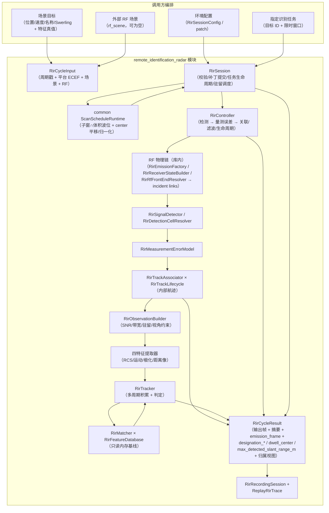

# Remote Identification Radar 数据流

## 数据流图



## 主链内部接口清单（自上而下）

本文将需求中的“回拨计算”统一按雷达领域语义记为“回波计算”。主处理顺序固定为：

```text
外部数据
  -> 驻留计划与 RF 周期状态
  -> 回波、干扰、杂波、噪声计算
  -> 目标检测与量测形成
  -> 点迹关联、滤波与航迹生命周期
  -> 特征提取
  -> 目标识别与结果装配
```

以下只登记生产链实际调用的接口。验收日志、DebugView、recorder 和 replay 属于观测或
持久化旁路，不参与探测、特征或识别判决。

### 1. 外部数据进入内部链

| 顺序 | 接口/数据契约 | 调用方 -> 被调用方 | 输入 | 输出或状态 | 实现位置 |
|---:|---|---|---|---|---|
| 1.1 | `RirSession::StepWithResult` | 集成方 -> `RirSession` | `RirCycleInput` | `RirCycleResult` | `include/1q/remote_identification_radar/session/RirSession.h` |
| 1.2 | `ValidateRirCycleInput` | `RirSession::Impl::RunCycle` -> 输入校验 | 周期号、时间、平台 ECEF、场景目标、外部 `rf_scene` | `RirIssueList`；失败时整周期拒绝 | `include/1q/remote_identification_radar/session/RirInputValidation.h`、`src/remote_identification_radar/session/RirInputValidation.cpp` |
| 1.3 | `RirController::UpdateRuntime` / `UpdateEnvironment` | `RirSession` -> `RirController` | mission、policy、environment 及已提交运行期补丁 | 更新探测、跟踪、识别与环境内部配置 | `src/remote_identification_radar/runtime/RirController.h/.cpp` |
| 1.4 | `BuildAbsoluteScanWaves` | `RirSession::Impl::RunCycle` -> common 扫描核 | 扫描子窗、可扫描体积、scan center、波束宽度 | 绝对 ENU 波位序列 | `src/remote_identification_radar/session/RirSession.cpp` |
| 1.5 | `RirController::RunCycle` | `RirSession` -> `RirController` | `RirCycleInput`、batch、驻留计划、扫描边界、指定目标 | 填充 `RirOutputFrame` 并刷新控制器周期状态 | `src/remote_identification_radar/runtime/RirController.h/.cpp` |

外部周期数据的核心载体是 `RirCycleInput`：`scene_targets` 提供目标 ENU 位置、速度、
探测 RCS、Swerling 类型及可选识别特征事实；`platform_position` 提供 ENU 锚点；
`rf_scene` 提供外部发射与干扰事实。硬件、任务、策略和环境来自 `RirSessionConfig` 或
运行期补丁，不经周期输入重复注入。

### 2. 回波计算与 RF 链

| 顺序 | 内部接口 | 上游输入 | 下游输出 | 实现位置 |
|---:|---|---|---|---|
| 2.1 | `RirController::ResolveEnvironment` | `RirEnvironmentConfig` | 会话级传播损耗 | `src/remote_identification_radar/runtime/RirController.cpp` |
| 2.2 | `RirEmissionFactory::ResolveCarrierHz` | 发射机配置、周期号 | 本周期载频 | `src/remote_identification_radar/dwell/RirEmissionFactory.h/.cpp` |
| 2.3 | `RirEmissionFactory::TryBuildEmission` | `RirRfCycleInput`、硬件、载频 | 本机 `RfEmission` | `src/remote_identification_radar/dwell/RirEmissionFactory.h/.cpp` |
| 2.4 | `RirReceiverStateBuilder::Build` | RF 周期输入、本机发射、硬件、载频 | `RirReceiverOperatingState` | `src/remote_identification_radar/dwell/RirReceiverStateBuilder.h/.cpp` |
| 2.5 | `TryResolveRirRfFrontEnd` | 外部 `RfSceneFrame`、本机发射与接收状态 | incident links、总入射功率、饱和状态 | `src/remote_identification_radar/dwell/RirRfFrontEndResolver.h/.cpp` |
| 2.6 | `RirController::ComputeLookAngles` | `RirSceneTarget` 的 ENU 位置 | 方位、俯仰、斜距 | `src/remote_identification_radar/runtime/RirController.cpp` |
| 2.7 | `RirResolveBeamStateForPointing` | 波束中心、目标视线角、天线与波长 | 有效波束宽度、单程方向图增益 | `src/remote_identification_radar/dwell/RirBeamControl.h` |
| 2.8 | `ComputeEffectiveTargetRcsM2` | 目标 RCS 物理配置、视线角、载频 | 探测链有效 RCS（m2） | `src/remote_identification_radar/dwell/RirEffectiveRcs.h/.cpp` |
| 2.9 | `ComputeTargetAtmosphericLossDb` | 载频、平台高度、目标高度与斜距 | 逐目标大气附加损耗 | `src/remote_identification_radar/runtime/RirController.cpp` |
| 2.10 | `ResolveTargetClutterPowerW` -> `RirSurfaceClutterModel::EvaluateClutterNoiseW` | 俯仰、斜距、传播损耗、硬件、植被档 | 主瓣地杂波等效功率（W） | `src/remote_identification_radar/runtime/RirController.cpp`、`src/remote_identification_radar/internal/RirSurfaceClutterModel.h/.cpp` |
| 2.11 | `RirRadarEquations::ComputeEchoPowerWithGain_dBW` | 发射机、单程增益、RCS、斜距、传播损耗 | 回波功率（dBW） | `src/remote_identification_radar/internal/RirRadarEquations.h/.cpp` |
| 2.12 | `RirRadarEquations::ComputeThermalNoisePower_W` | 带宽、接收机噪声系数 | 热噪声功率（W） | `src/remote_identification_radar/internal/RirRadarEquations.h/.cpp` |

`RirController::ResolveRfCycle` 是 2.2 到 2.5 的编排边界，产出
`RirResolvedRfCycle`。主 RF 链解析成功时，回波事实继续进入 detection cell；解析失败时，
`RirSignalDetector::Detect` 使用 2.11/2.12 的简化回退链，且不注入外部干扰。

### 3. 目标检测、量测与内部航迹

| 顺序 | 内部接口 | 上游输入 | 下游输出 | 实现位置 |
|---:|---|---|---|---|
| 3.1 | `RirController::TryBuildMeasurement` | 单目标、驻留中心、RF 周期、传播/杂波事实 | `RirTrackMeasurement`、SNR；未通过门控时返回 false | `src/remote_identification_radar/runtime/RirController.h/.cpp` |
| 3.2 | `TryResolveRirDetectionCell` | 冻结波形/接收参数、目标回波事实、incident links、杂波 | `RirDetectionCellResult` 分项 SINR 账本 | `src/remote_identification_radar/dwell/RirDetectionCellResolver.h/.cpp` |
| 3.3 | `RirSignalDetector::DetectResolvedCell` | 目标起伏模型、已求解 detection cell | 回波功率、SNR、Pd、`detected` | `src/remote_identification_radar/dwell/RirSignalDetector.h/.cpp` |
| 3.4 | `RirSignalDetector::Detect` | 目标、环境噪声、天线增益、脉冲数 | RF 失败时的回退探测结果 | `src/remote_identification_radar/dwell/RirSignalDetector.h/.cpp` |
| 3.5 | `RirMeasurementErrorModel::Compute` | 有效 SNR、带宽、波束宽度 | 距离/角度 bias 与标准差 | `src/remote_identification_radar/dwell/RirMeasurementErrorModel.h` |
| 3.6 | `MakeCartesianMeasurementCovariance` / `SampleMeasurementPosition` | 球坐标误差、目标位置、随机源 | 笛卡尔量测协方差及检测位置 | `src/remote_identification_radar/runtime/RirController.cpp` |
| 3.7 | `RirTrackAssociator::Associate` | 本周期量测、`BuildAssociationSeeds()`、dt | 已分配 association key 的量测、命中对、漏检键 | `src/remote_identification_radar/tracking/RirTrackAssociator.h/.cpp` |
| 3.8 | `RirTrackLifecycle::Update` | 关联后量测、周期上下文 | 推进 CV KF/IMM 和 tentative/confirmed/lost/回收状态 | `src/remote_identification_radar/tracking/RirTrackLifecycle.h/.cpp` |
| 3.9 | `RirTrackLifecycle::BuildTrackSnapshots` | 生命周期内部状态 | 按 association key 排序的 `RirTrackState` | `src/remote_identification_radar/tracking/RirTrackLifecycle.h/.cpp` |

3.7 到 3.9 是检测点迹进入识别链前的必要桥接。检测量测只在模块内部消费，不通过
public API 输出；后续特征提取消费的是滤波后的内部航迹快照。

### 4. 特征提取

| 顺序 | 内部接口 | 输入 | 输出 | 实现位置 |
|---:|---|---|---|---|
| 4.1 | `RirController::MakeObservationContext` | 场景目标、航迹、SNR、带宽、驻留与平台高度 | `RirObservationContext` | `src/remote_identification_radar/runtime/RirController.cpp` |
| 4.2 | `RirObservationBuilder::Build` | 场景目标、`RirTrackState`、观测上下文 | `RirFeatureSet` 与有效维掩码 | `src/remote_identification_radar/recognition/RecognitionObservationBuilder.h/.cpp` |
| 4.3 | `RirRcsFeatureExtractor::Extract` | 视角 RCS 样本、视线角、SNR、覆盖要求 | `RirRcsObservation` | `src/remote_identification_radar/recognition/RcsFeatureExtractor.h/.cpp` |
| 4.4 | `RirMotionFeatureExtractor::Extract` | confirmed 航迹、平台高度、估计不确定度 | `RirMotionObservation` | `src/remote_identification_radar/recognition/MotionFeatureExtractor.h/.cpp` |
| 4.5 | `RirPolarizationFeatureExtractor::Extract` | 极化散射样本、视线角、SNR、斜距 | `RirPolarizationObservation` | `src/remote_identification_radar/recognition/PolarizationFeatureExtractor.h/.cpp` |
| 4.6 | `RirRangeProfileFeatureExtractor::Extract` | 距离向散射中心、带宽、SNR、分辨率要求 | `RirRangeProfileObservation` | `src/remote_identification_radar/recognition/RangeProfileFeatureExtractor.h/.cpp` |

4.3 到 4.6 由 4.2 统一编排。任一维度不满足 SNR、覆盖、航迹状态或分辨率要求时，
只将该维标为无效；全部维度无效时，本周期不进入识别积累。

### 5. 目标识别与产品装配

| 顺序 | 内部接口 | 输入 | 输出或状态 | 实现位置 |
|---:|---|---|---|---|
| 5.1 | `RirFeatureDatabase::Load` | SQLite 特征库路径 | 只读内存 `RirFeatureDatabase` | `src/remote_identification_radar/recognition/RecognitionFeatureDatabase.h/.cpp` |
| 5.2 | `RirTracker::UpdateCycle` | 航迹快照、目标回联上下文、数据库、权重、周期信息 | 更新逐航迹积累状态；可返回本周期有效特征观测 | `src/remote_identification_radar/recognition/RecognitionTracker.h/.cpp` |
| 5.3 | `RirMatcher::QueryBestMatch` | 聚合特征、观测上下文、数据库、权重 | 最优型号、类别、得分、margin 和分项相似度 | `src/remote_identification_radar/recognition/RecognitionMatcher.h/.cpp` |
| 5.4 | `RirTracker::FindResult` | association key | `RirRecognitionResult` | `src/remote_identification_radar/recognition/RecognitionTracker.h/.cpp` |
| 5.5 | `RirTracker::BuildSummary` | 本周期航迹快照 | `RirRecognitionCycleSummary` | `src/remote_identification_radar/recognition/RecognitionTracker.h/.cpp` |
| 5.6 | `RirController::RunCycle` 输出装配段 | 识别结果、有效特征观测、航迹快照、发射帧 | `recognition_outputs`、`feature_measurements`、归属与摘要 | `src/remote_identification_radar/runtime/RirController.cpp` |

`RirTracker::UpdateCycle` 内部先调用 `RirObservationBuilder::Build`，通过质量门后再调用
`RirMatcher::QueryBestMatch`，最后推进识别状态机。特征量测在积累质量门之前采集，因此
“可对外形成特征量测”不等于“本周期可用于型号确认”。

### 主调用栈速查

```text
RirSession::StepWithResult
  -> RirSession::Impl::RunCycle
     -> ValidateRirCycleInput
     -> BuildAbsoluteScanWaves / 生成 RirDwellPlan
     -> RirController::RunCycle
        -> ResolveRfCycle
           -> RirEmissionFactory::TryBuildEmission
           -> RirReceiverStateBuilder::Build
           -> TryResolveRirRfFrontEnd
        -> TryBuildMeasurement                         [逐驻留、逐目标]
           -> RirResolveBeamStateForPointing
           -> ComputeEffectiveTargetRcsM2
           -> TryResolveRirDetectionCell
           -> RirSignalDetector::DetectResolvedCell
           -> RirMeasurementErrorModel::Compute
        -> RirTrackAssociator::Associate
        -> RirTrackLifecycle::Update
        -> RirTrackLifecycle::BuildTrackSnapshots
        -> RirTracker::UpdateCycle
           -> RirObservationBuilder::Build
              -> RirRcsFeatureExtractor::Extract
              -> RirMotionFeatureExtractor::Extract
              -> RirPolarizationFeatureExtractor::Extract
              -> RirRangeProfileFeatureExtractor::Extract
           -> RirMatcher::QueryBestMatch
        -> RirTracker::BuildSummary / FindResult
        -> 组装 RirOutputFrame 与 RirCycleResult
```

## 单周期时序（StepWithResult）

1. **关机检查**：`sensor_enabled == false` → `kPoweredOff` 三写（`abort_reason` +
   `rir.sensor_powered_off` + `PROJECT_LOG`），不触碰检测/跟踪/识别状态。
2. **入口校验**：`ValidateRirCycleInput`（dt 有限为正、周期号非零、仿真时间
   有限、平台 ECEF 必填 fail-closed——分量有限且模长>0、须可转 LLA、场景目标
   位置/速度/RCS/斜距/特征样本有限、Swerling 取值合法、外部 `rf_scene`
   帧合法且窗口与 `sim_time_sec`/驻留对齐）；失败 → `kRejectedInvalidInput` 三写
   （校验 issues 本身即写二，再补 abort_reason 与 `PROJECT_LOG`）。
3. **补丁提交**（staged）：`RirRuntimeConfigPatch` 在下一个成功周期边界应用
   （电源/工作模式/转台朝向 `has_scan_center`/完整 policy/environment 域/
   指定识别任务字段）→ `RirController::UpdateRuntime` / `UpdateEnvironment`。
4. **指定识别任务推进 + 驻留调度**（`RirSession`）：任务生命周期逐周期推进
   （kNone → kPending → kAcquired | kExpired，镜像 AR 骨架）；驻留中心 =
   任务窗口内指定目标视线角（在体积内），否则「子窗 ∩ 体积」搜索扇区 + scan_center
   扫描波位。
5. **自持链路执行**：`kIdentify` 门控整链：
   - **RF 物理链**（库内）：`ResolveRfCycle` 构建自发射（`RirEmissionFactory`）+
     接收机状态（`RirReceiverStateBuilder`）→ 合并 `rf_scene` 外部 emission →
     `TryResolveRirRfFrontEnd` 求解 incident links；有效 RCS 经
     `ComputeEffectiveTargetRcsM2`（AR 同口径）写入 detection cell 目标；
   - 驻留候选排序：未识别优先 + 斜距次近（消费上一周期内部航迹结论；
     只决定候选顺序，不生成波束指向）；
   - **地球遮挡门控（2026-08-27）**：平台 ECEF + 目标 ENU 还原 ECEF 后做有限弦-
     圆球判定（`common/geometry/EarthOccultation`，R=6371 km，相切算遮挡）；
     穿地目标不入候选并落 `rir.target_earth_occulted`（规则 13b）；还原失败跳过本门；
   - **搜索角域裁剪（2026-08-22 甲方批注「设定方位俯仰进行扫描」+「任务范围由用户指定」）**：
     检测候选集 = 视线角落在**实际搜索扇区**（`mission.scan_window_deg` ∩
     `orientation.steerable_volume_deg`，`internal/IntersectScanSector`）内的场景目标
     （az 相对 `scan_center` 归一化、el 绝对，`internal/RirScanVolume.h` 与指定目标
     驻留门单源同口径）；被指定的目标在体积内豁免子窗。扇区外目标不入候选并落
     `rir.target_outside_search_volume` 排除诊断（规则 13b，区分出体积/出子窗两类门），
     `scan_center` 运行期补丁即「设定方位俯仰」；
   - 波束状态：消费驻留调度显式给定的波束中心（雷达局部 ENU 系，
     `az ∈ [-180, 180]`、`el ∈ [-90, 90]`），与同帧目标视线角相减求离轴增益；
     方向图恒开（开关已删，2026-08-29），无有效视线角时回退主瓣峰值；检测候选
     另受主瓣覆盖门约束（契约见 boundaries.md）；
   - 检测：RF 链解析成功时走 `TryResolveRirDetectionCell` 分项 SINR 账本
     （含传播损耗/杂波/外部干扰）；杂波为逐目标物理求解
     （`ResolveTargetClutterPowerW` → `internal/RirSurfaceClutterModel`，
     按目标斜距/俯仰擦地角与雷达参数计算，植被关闭恒 0）；解析失败或环境
     未启用时退化为阶段 1 旧 SNR 口径；6 dB 回退模式以 SNR ≥ 6 dB 替代 CFAR
     判决（旧识别门控口径）；
   - 量测误差：距离/角度标准差 → 笛卡尔协方差；检测器门控模式采样量测位置，
     回退模式量测位置取真值；
   - 关联/滤波/生命周期：LAPJV 全局最优关联（方阵代价矩阵 + 未分配代价）
     → CV KF 或 IMM（confirmed 命中激活，`enable_imm_lifecycle` 缺省开启）预测/更新
     → confirm/lost/回收（池化槽位 + `generation` 复用代次）；
   - 识别积累：内部航迹按 `external_target_id` 回联场景目标，逐航迹
     `UpdateCycle` 积累/匹配/判定（可选出参采集本周期实际构建的有效特征观测，
     供出口①透出）；非 `kIdentify` → `HoldCycle`；
     退出 `kIdentify` → `ExitRecognitionMode`。
6. **输出装配（双产品）**：逐内部航迹结论回填 `RirOutputFrame::recognition_outputs`
   （按关联键升序，出口②）；特征量测记录回填 `feature_measurements`（出口①：
   采集观测 × 观测上下文 + 平台位置，透出原则——识别链未构建观测的周期为空）；
   `RirCycleResult::emission_frame` 在 `kIdentify` 且 RF 链成功时携带本周期
   逐驻留实际发射（2026-08-30 核查 9.2：一驻留一条、指向=该驻留波位、
   emission_id 帧内唯一，单驻留周期恰一条；接收侧聚合语义不变，
   供编排层汇集 RF scene，与 AR 同契约）；同循环构建归属视图缓存（`RirController::LatestTrackAttributions`），会话在
   kCompleted 后回填 `RirCycleResult::track_attributions`；非执行周期产品层与
   归属层均为空（五模块统一规则）。`RirRecognitionCycleSummary` 含识别统计、
   真值准确率与驻留预算摘要。
7. **replay**：公开 `RirRecordingSession` / `ReplayRirTrace`；内部
   `RirSessionReplayAccess::CaptureSessionState` 采集
   `active_database_version` + 检测随机种子；周期记录经 `RirReplayFlatbufferCodec`
   编入 Replay 目录。
   V2 编解码，旧 V1 显式拒绝；输出帧特征量测向量、结果表归属向量与
   `emission_frame` 为加性扩展（`RIR2` 标识不变，旧记录缺字段解码为空）。
   指定任务生命周期阶段
   （designation_phase/deadline）为派生跨周期状态，不进 replay session state：
   全量重放由 patch 流 + cycle_index 驱动可复现；若未来引入"从第 N 周期恢复"，
   需同步纳入会话状态。

## 状态所有权

| 状态 | 持有者 | 生命周期 |
|---|---|---|
| `RirFeatureDatabase` | `RirController` | 路径变更时按需重载；加载期只读连接，运行期无连接 |
| 内部航迹 `RirTrackState` | `RirTrackLifecycle` | 关联命中建轨；lost 超时回收；键单调不回收复用 |
| KF 高斯状态 | `RirTrackFilter`（经 lifecycle 持有） | 命中更新/失配外推；lost 重捕获重置 |
| 关联键分配器 `next_key` | `RirTrackAssociator` | 单调递增；运行态可捕获恢复 |
| 每航迹识别积累窗口/结论 | `RirTracker` | 随内部航迹键创建；回收/退出识别模式清理 |
| 检测 RNG 与量测误差 RNG | `RirController` | 随 `policy.detection.random_seed` 重置，种子入 replay |
| `latest_summary` | `RirController` | 每成功周期刷新 |
| `last_track_attributions`（归属视图缓存） | `RirController` | 每执行周期随快照刷新；非执行周期不触碰（会话早退保持空列表） |
| 指定任务状态（ID/时长/阶段/截止） | `RirSession` | 随 patch 原子提交；识别达成/作废后窗口停止（终态），结果级指定清零，清除需新 patch |
| `active_database_version` / `detection_random_seed` | `RirController` → `RirSessionReplayState` | 随运行期更新，入 replay |

## 与 AR 的关系

RIR **不 include 任何 AR 头**，不消费任何 AR 输出，也不向 AR 提供航迹、识别
结论或波束控制。AR 与 RIR 仅为同库共存的两部独立装备，由调用方分别编排；
RIR 波束中心由库内驻留调度器（`RirSession`：相对体积 + scan_center 平移归一化，
或指定识别任务限位执行）派生，经 `RirCycleResult::dwell_center_deg` 暴露；RIR 不驱动任何外部雷达波束。
编排层汇集实际发射走 `RirCycleResult::emission_frame`（与 AR 同契约）。
